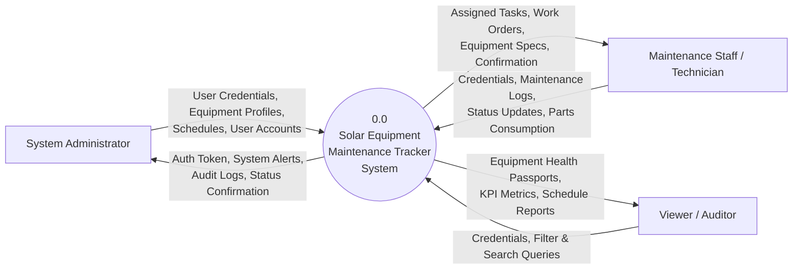
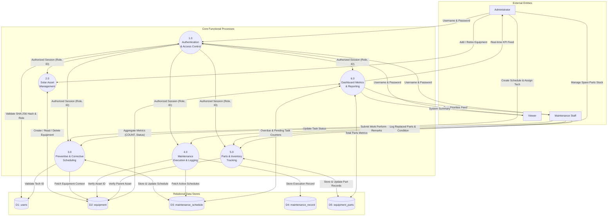
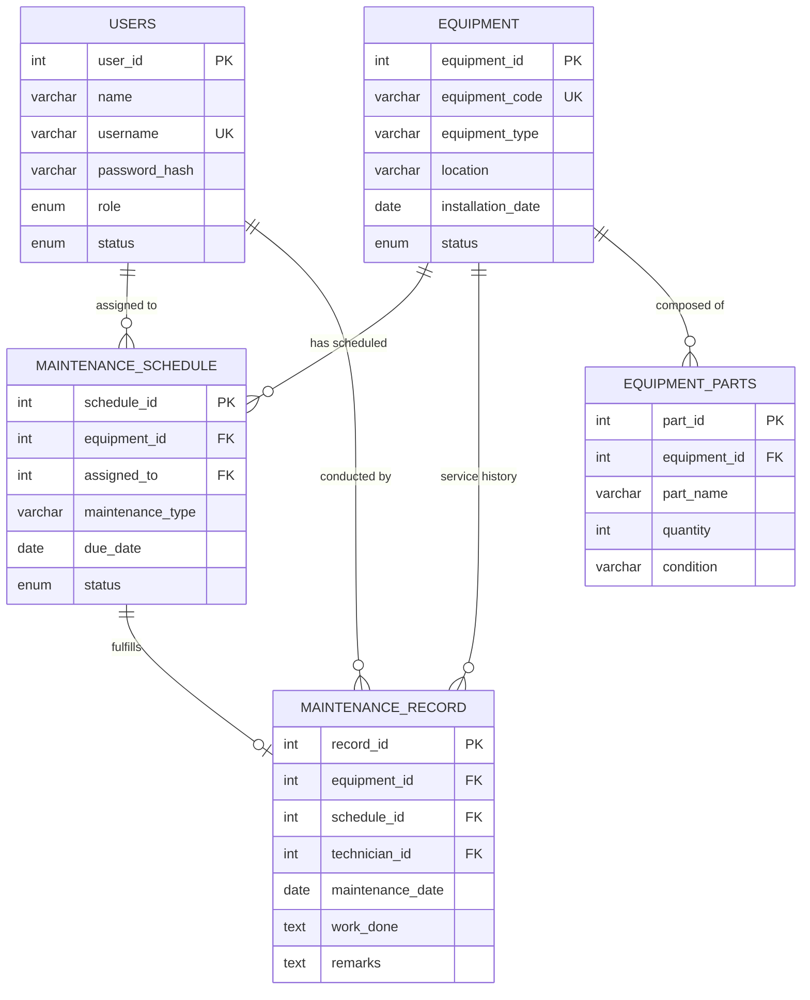
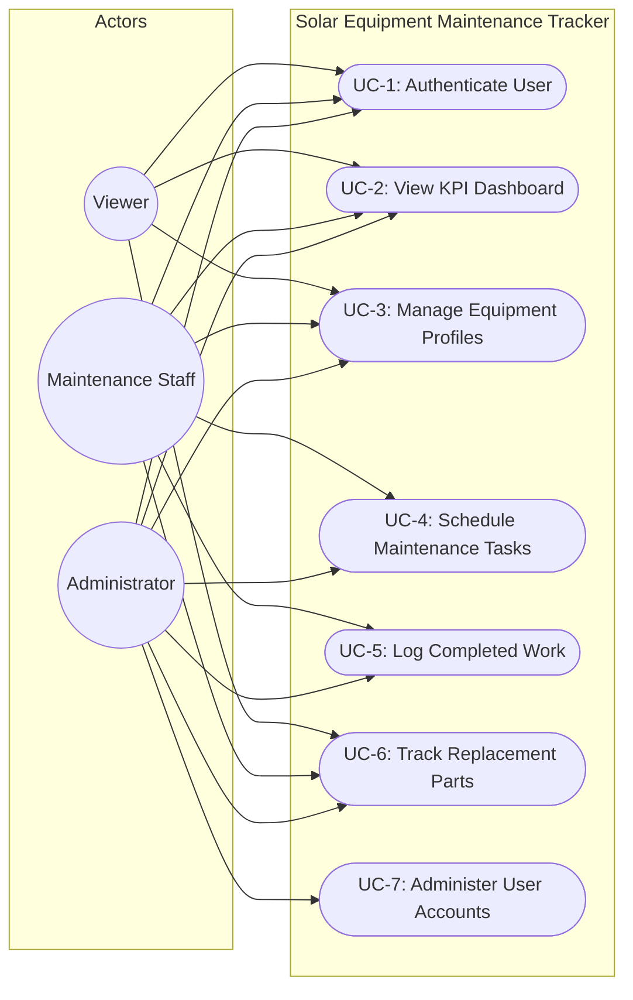
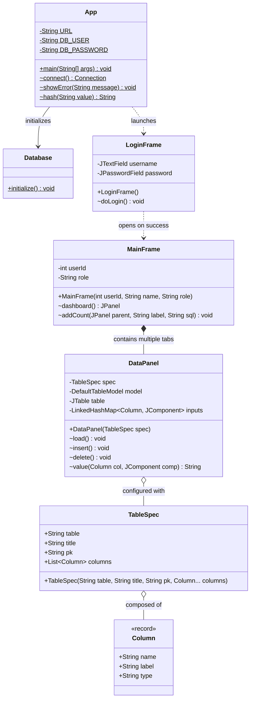
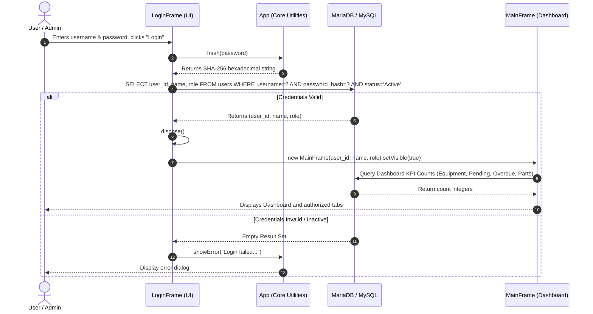
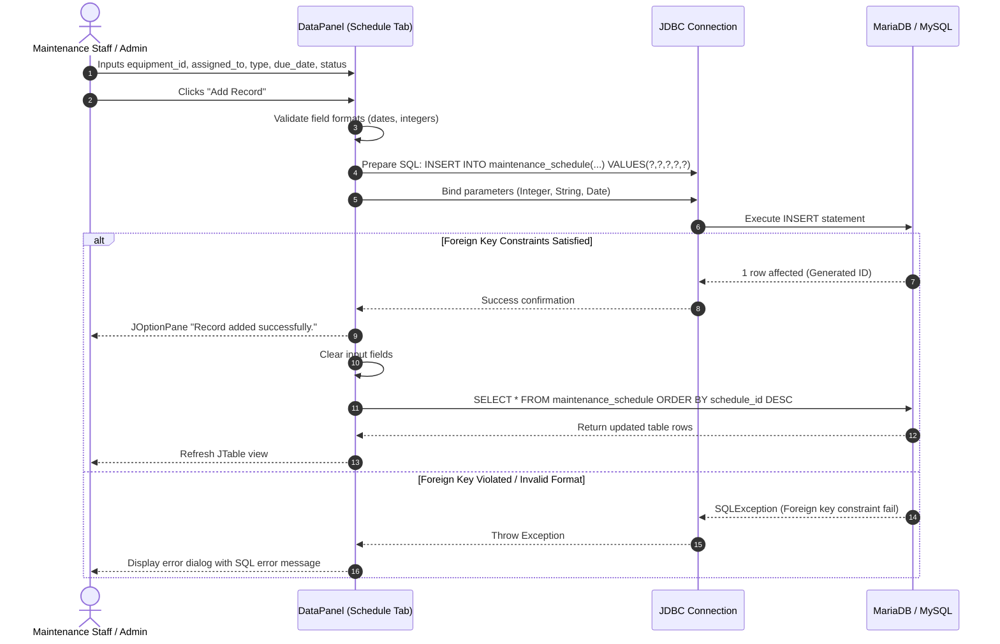

# CHAPTER 3: DESIGN

---

## 3.1 Data Flow Diagram (DFD)

A Data Flow Diagram (DFD) graphically represents how data moves through the Solar Equipment Maintenance Tracker system. It models external entities that interact with the application, the internal processes that transform data, and the data stores where information is persisted.

### 3.1.1 Level 0 DFD (Context Diagram)

The Level 0 Context Diagram establishes the boundary of the system. It views the entire application as a single centralized process interacting with three external human actors: **System Administrator**, **Maintenance Staff (Technicians)**, and **Viewers / Auditors**.



**Figure 3.1: Level 0 DFD (Context Analysis Diagram)**

#### Data Flow Descriptions (Level 0):
1. **User Authentication & Authorization**: All users provide login credentials (username and plaintext password). The system responds with authentication tokens, role designations, and permitted module views.
2. **Asset Management Inflow**: Administrators register solar arrays, string inverters, battery storage banks, and weather stations.
3. **Operational Workflows**: Maintenance technicians query pending schedules, record corrective or preventive service logs, update equipment health statuses, and track replaced components.
4. **Analytical Outflow**: Management and viewers query real-time equipment status, overdue preventive maintenance tickets, and overall plant health.

---

### 3.1.2 Level 1 DFD (Decomposed System Architecture)

The Level 1 DFD decomposes process `0.0` into sub-processes, identifying the distinct relational data stores (`D1` through `D5`) and data flows between them.



**Figure 3.2: Level 1 DFD (Detailed Functional Process Decomposition)**

---

## 3.2 ER Diagram and Database Design

The relational database schema is structured in Third Normal Form (3NF) to eliminate data redundancy and preserve referential integrity across solar equipment, users, schedules, logs, and replacement components.

### 3.2.1 Entity-Relationship (ER) Diagram



**Figure 3.3: Entity-Relationship Diagram (ERD)**

---

### 3.2.2 Database Table Structures

The underlying database `solar_maintenance` uses the MySQL InnoDB storage engine, which provides full ACID compliance, row-level locking, and foreign key constraint enforcement.

#### Table 4.1: Database Table Structure – `users`
*Description*: Manages internal application user profiles, credentials, security roles, and active account status.

| Field Name | Data Type | Size | Key / Constraint | Description |
| :--- | :--- | :--- | :--- | :--- |
| `user_id` | INT | 11 | PRIMARY KEY, AUTO_INCREMENT | Unique identifier for system user |
| `name` | VARCHAR | 100 | NOT NULL | Full human-readable user name |
| `username` | VARCHAR | 60 | NOT NULL, UNIQUE | System login credential handle |
| `password_hash` | VARCHAR | 64 | NOT NULL | SHA-256 cryptographic digest of password |
| `role` | ENUM | - | NOT NULL, DEFAULT 'Viewer' | Access control: 'Administrator', 'Maintenance Staff', 'Viewer' |
| `status` | ENUM | - | NOT NULL, DEFAULT 'Active' | Account life-cycle status: 'Active', 'Inactive' |

---

#### Table 4.2: Database Table Structure – `equipment`
*Description*: Registers physical solar field equipment assets, locations, operational statuses, and commissioning dates.

| Field Name | Data Type | Size | Key / Constraint | Description |
| :--- | :--- | :--- | :--- | :--- |
| `equipment_id` | INT | 11 | PRIMARY KEY, AUTO_INCREMENT | Unique identifier for each physical asset |
| `equipment_code` | VARCHAR | 40 | NOT NULL, UNIQUE | Serialized barcoded tag (e.g., 'INV-STR-001') |
| `equipment_type` | VARCHAR | 100 | NOT NULL | Category (e.g., 'Central Inverter', 'PV String') |
| `location` | VARCHAR | 150 | NOT NULL | Geographic/Physical location (e.g., 'Array Zone B-4') |
| `installation_date` | DATE | - | NULL | Date of installation and grid commissioning |
| `status` | ENUM | - | NOT NULL, DEFAULT 'Active' | Health state: 'Active', 'Under Maintenance', 'Inactive' |

---

#### Table 4.3: Database Table Structure – `maintenance_schedule`
*Description*: Organizes planned, preventive, and reactive maintenance jobs assigned to technical staff.

| Field Name | Data Type | Size | Key / Constraint | Description |
| :--- | :--- | :--- | :--- | :--- |
| `schedule_id` | INT | 11 | PRIMARY KEY, AUTO_INCREMENT | Unique maintenance schedule identifier |
| `equipment_id` | INT | 11 | NOT NULL, FOREIGN KEY | References `equipment(equipment_id)` |
| `assigned_to` | INT | 11 | NULL, FOREIGN KEY | References `users(user_id)` ON DELETE SET NULL |
| `maintenance_type` | VARCHAR | 100 | NOT NULL | Category (e.g., 'Preventive Inspection', 'Filter Cleaning') |
| `due_date` | DATE | - | NOT NULL | Scheduled deadline date for service execution |
| `status` | ENUM | - | NOT NULL, DEFAULT 'Pending' | Execution state: 'Pending', 'Completed', 'Overdue' |

---

#### Table 4.4: Database Table Structure – `maintenance_record`
*Description*: Permanent audit log of maintenance activities performed, technical observations, and technician sign-offs.

| Field Name | Data Type | Size | Key / Constraint | Description |
| :--- | :--- | :--- | :--- | :--- |
| `record_id` | INT | 11 | PRIMARY KEY, AUTO_INCREMENT | Unique service log identifier |
| `equipment_id` | INT | 11 | NOT NULL, FOREIGN KEY | References `equipment(equipment_id)` |
| `schedule_id` | INT | 11 | NULL, FOREIGN KEY | References `maintenance_schedule(schedule_id)` ON DELETE SET NULL |
| `technician_id` | INT | 11 | NULL, FOREIGN KEY | References `users(user_id)` ON DELETE SET NULL |
| `maintenance_date` | DATE | - | NOT NULL | Date work was physically carried out |
| `work_done` | TEXT | - | NOT NULL | Granular description of tasks completed |
| `remarks` | TEXT | - | NULL | Diagnostic notes, observations, or warnings |

---

#### Table 4.5: Database Table Structure – `equipment_parts`
*Description*: Catalogs spare parts, field replacements, and consumables allocated to specific solar assets.

| Field Name | Data Type | Size | Key / Constraint | Description |
| :--- | :--- | :--- | :--- | :--- |
| `part_id` | INT | 11 | PRIMARY KEY, AUTO_INCREMENT | Unique identifier for the equipment part |
| `equipment_id` | INT | 11 | NOT NULL, FOREIGN KEY | References `equipment(equipment_id)` |
| `part_name` | VARCHAR | 100 | NOT NULL | Nomenclature of component (e.g., '1000V DC Fuse 15A') |
| `quantity` | INT | 11 | NOT NULL, DEFAULT 0 | Count of installed/available spare units |
| `condition` | VARCHAR | 60 | NOT NULL, DEFAULT 'Good' | Physical/operational state (e.g., 'New', 'Good', 'Worn') |

---

## 3.3 Unified Modelling Language (UML)

### 3.3.1 Use Case Diagram
The Use Case Diagram defines the interactions between the system actors and the primary functional features.



**Figure 3.4: UML Use Case Diagram**

---

### 3.3.2 Class Diagram
The Class Diagram models the object-oriented structure of the application, showing class attributes, methods, records, and relationships.



**Figure 3.5: UML Class Diagram**

---

### 3.3.3 Sequence Diagrams

#### Sequence Diagram 1: User Authentication Flow
Illustrates the chronological interaction sequence during system login, SHA-256 credential hashing, database validation, and dashboard presentation.



**Figure 3.6: UML Sequence Diagram – Authentication & Workspace Initialization**

---

#### Sequence Diagram 2: Maintenance Schedule Creation Flow
Illustrates data validation and insertion of a maintenance ticket with foreign key references.



**Figure 3.7: UML Sequence Diagram – Preventive Maintenance Task Scheduling**

---

# CHAPTER 4: IMPLEMENTATION AND TESTING (JAVA)

---

## 4.1 Project Structure (Packages and Classes)

The project follows a standard Maven directory layout. The code is packaged under `com.piet.solar` and utilizes modern Java 21 LTS features, including `record` classes, pattern matching, `HexFormat`, and try-with-resources resource management.

```
solar-maintenance-tracker/
├── pom.xml                               # Maven project object model and dependency management
├── README.md                             # Project overview and run guides
├── start_gui.sh                          # Headless Linux / Codespaces VNC display launcher
├── schema.sql                            # Full DDL database definitions and sample seed
├── src/
│   └── main/
│       └── java/
│           └── com/
│               └── piet/
│                   └── solar/
│                       └── App.java      # Consolidated high-cohesion application source
└── target/                               # Compiled bytecode and packaged JAR binaries
```

### Class and Component Descriptions:

1. **`com.piet.solar.App`**:
   - **Role**: Primary application orchestrator.
   - **Responsibilities**: Contains the `main()` method, environment variable resolution for database credentials (`SOLAR_DB_URL`, `SOLAR_DB_USER`, `SOLAR_DB_PASSWORD`), static JDBC connection factory `connect()`, error modal utilities `showError()`, and SHA-256 cryptographic hashing helper `hash()`.

2. **`com.piet.solar.App.Database`**:
   - **Role**: Automated Schema Migrator and Seeder.
   - **Responsibilities**: Contains `initialize()`, which executes `CREATE TABLE IF NOT EXISTS` DDL statements for all 5 entities on system startup and provisions the initial default Administrator (`admin` / `admin123`) using `INSERT IGNORE`.

3. **`com.piet.solar.App.LoginFrame`**:
   - **Role**: Swing Graphical Authentication View.
   - **Responsibilities**: Provides visual input controls for user credentials, binds `ActionListener` triggers to Enter keypresses and the Login button, executes parameterized queries against `users`, and opens `MainFrame`.

4. **`com.piet.solar.App.MainFrame`**:
   - **Role**: Central Application Shell and Tabbed Navigator.
   - **Responsibilities**: Implements the main window layout, top-bar session indicators, and dynamic `JTabbedPane`. Conditionally mounts the `Users` administrative tab only when `role.equals("Administrator")`. Houses the real-time KPI analytical dashboard.

5. **`com.piet.solar.App.DataPanel`**:
   - **Role**: Generic Metadata-Driven CRUD Panel.
   - **Responsibilities**: Dynamically constructs forms, data grids (`JTable`), and action toolbars for any entity based on its `TableSpec`. Provides automated SQL generation for dynamic inserts, deletes, and table reloads.

6. **`com.piet.solar.App.TableSpec`**:
   - **Role**: Metadata Descriptor Object.
   - **Responsibilities**: Encapsulates table names, display titles, primary key columns, and field definitions to drive `DataPanel`.

7. **`com.piet.solar.App.Column`**:
   - **Role**: Strongly-typed Java Record.
   - **Responsibilities**: Encapsulates database column names, human-readable UI labels, and rendering types (`text`, `number`, `nullableNumber`, `date`, `password`).

---

## 4.2 Modules Description

### 1. Authentication & Access Control Module
- **Classes**: `App`, `App.LoginFrame`
- **Key Methods**: `doLogin()`, `hash(String value)`, `connect()`
- **Description**: Verifies user authenticity by taking plaintext input from `JPasswordField`, generating a 256-bit SHA-256 digest via `MessageDigest.getInstance("SHA-256")`, and querying the `users` table for an active account with matching credentials. On success, the login window is disposed of and `MainFrame` is launched with the user's role and session details.

### 2. Analytical Dashboard & Health Passport Module
- **Classes**: `App.MainFrame`
- **Key Methods**: `dashboard()`, `addCount(JPanel parent, String label, String sql)`
- **Description**: Serves as the executive overview screen. Displays 4 real-time KPI metrics cards:
  - *Total Equipment*: `SELECT COUNT(*) FROM equipment`
  - *Pending Maintenance*: `SELECT COUNT(*) FROM maintenance_schedule WHERE status='Pending'`
  - *Overdue Maintenance*: Evaluates SLA breaches using `SELECT COUNT(*) FROM maintenance_schedule WHERE status='Overdue' OR (status='Pending' AND due_date < CURDATE())`
  - *Parts Entries*: `SELECT COUNT(*) FROM equipment_parts`
  Each card features an independent "Refresh" button triggering asynchronous database counts.

### 3. Solar Asset Management Module
- **Classes**: `App.DataPanel`, `App.TableSpec`
- **Key Methods**: `load()`, `insert()`, `delete()`
- **Description**: Manages solar equipment assets (e.g., inverters, PV modules, battery strings, transformers). Captures equipment code, equipment type, location, installation date, and operational status (`Active`, `Under Maintenance`, `Inactive`).

### 4. Maintenance Scheduling & Task Assignment Module
- **Classes**: `App.DataPanel`, `App.TableSpec`
- **Key Methods**: `load()`, `insert()`, `delete()`
- **Description**: Coordinates planned preventive inspections, cleaning schedules, and repair interventions. Links specific equipment to assigned technicians, establishes target completion due dates, and tracks task statuses (`Pending`, `Completed`, `Overdue`).

### 5. Maintenance Execution & Logging Module
- **Classes**: `App.DataPanel`, `App.TableSpec`
- **Key Methods**: `load()`, `insert()`, `delete()`
- **Description**: Captures completed maintenance activities for audit compliance. Technicians select the asset, link the schedule ID, record the service date, document detailed work done, and log engineering remarks.

### 6. Spare Parts & Inventory Condition Module
- **Classes**: `App.DataPanel`, `App.TableSpec`
- **Key Methods**: `load()`, `insert()`, `delete()`
- **Description**: Tracks spare components associated with specific equipment (e.g., DC fuses, surge arresters, cooling fans, bypass diodes). Monitors available stock quantities and component condition ratings (`Good`, `Worn`, `Needs Replacement`).

### 7. User Administration Module (Admin Only)
- **Classes**: `App.MainFrame`, `App.DataPanel`
- **Key Methods**: `insert()`, `hash()`, `delete()`
- **Description**: Secure module accessible exclusively by users holding the `Administrator` role. Allows provisioning new personnel, assigning system access roles (`Administrator`, `Maintenance Staff`, `Viewer`), setting account statuses, and hashing passwords on creation.

---

## 4.3 Database Connectivity (JDBC)

Database connectivity is managed through the official Oracle MySQL Connector/J driver (`com.mysql:mysql-connector-j:9.5.0`). The application establishes connections using JDBC URL connection parameters designed for high availability and standard compliance.

### 4.3.1 Connection Specification
- **Database Engine**: MySQL 8.x / MariaDB 10.11+
- **JDBC Driver Class**: `com.mysql.cj.jdbc.Driver`
- **Default Database Name**: `solar_maintenance`
- **Default Connection URL**:
  `jdbc:mysql://localhost:3306/solar_maintenance?serverTimezone=UTC&useSSL=false&allowPublicKeyRetrieval=true`
- **Configurable Environment Variables**:
  - `SOLAR_DB_URL`: Custom database connection string.
  - `SOLAR_DB_USER`: Custom database username (defaults to `root`).
  - `SOLAR_DB_PASSWORD`: Database authentication password.

### 4.3.2 Implementation Details

```java
package com.piet.solar;

import java.sql.Connection;
import java.sql.DriverManager;
import java.sql.PreparedStatement;
import java.sql.ResultSet;
import java.sql.SQLException;

public class App {
    private static final String URL = System.getenv().getOrDefault(
        "SOLAR_DB_URL",
        "jdbc:mysql://localhost:3306/solar_maintenance?serverTimezone=UTC&useSSL=false&allowPublicKeyRetrieval=true"
    );
    private static final String DB_USER = System.getenv().getOrDefault("SOLAR_DB_USER", "root");
    private static final String DB_PASSWORD = System.getenv().getOrDefault("SOLAR_DB_PASSWORD", "");

    // Static JDBC Connection Factory
    static Connection connect() throws SQLException {
        return DriverManager.getConnection(URL, DB_USER, DB_PASSWORD);
    }
}
```

### 4.3.3 Query Execution Methodology
1. **Parameterized Queries (`PreparedStatement`)**:
   All user-supplied inputs across authentication and data entry are bound using `PreparedStatement` with typed placeholders (`?`). This completely mitigates SQL Injection (SQLi) risks:
   ```java
   String sql = "INSERT INTO users (name, username, password_hash, role, status) VALUES (?, ?, ?, ?, 'Active')";
   try (PreparedStatement p = c.prepareStatement(sql)) {
       p.setString(1, "John Doe");
       p.setString(2, "jdoe");
       p.setString(3, hash("Secret123"));
       p.setString(4, "Maintenance Staff");
       p.executeUpdate();
   }
   ```
2. **Deterministic Hashing**:
   Passwords are never stored in plaintext. They are converted to SHA-256 digests before being written or evaluated in SQL queries:
   ```java
   static String hash(String value) throws Exception {
       byte[] bytes = MessageDigest.getInstance("SHA-256").digest(value.getBytes(StandardCharsets.UTF_8));
       return HexFormat.of().formatHex(bytes);
   }
   ```
3. **Automatic Resource Deallocation**:
   All database operations utilize Java `try-with-resources` blocks to guarantee immediate closing of `Connection`, `Statement`, and `ResultSet` handles, preventing connection pooling leaks.

---

## 4.4 Testing

The application underwent unit, integration, and user-interface testing. Table 5 details the test cases across all modules, including valid inputs, boundary conditions, edge cases, and invalid inputs.

#### Table 5: Test Cases

| TC ID | Module | Test Description | Input Data | Expected Output | Actual Output | Status |
| :--- | :--- | :--- | :--- | :--- | :--- | :--- |
| **TC-01** | Auth | Valid administrator login | User: `admin`, Pass: `admin123` | Login succeeds; `MainFrame` opens with all tabs including Users | Login successful; Admin dashboard displayed | **PASSED** |
| **TC-02** | Auth | Invalid password attempt | User: `admin`, Pass: `wrongpass` | Error modal: "Login failed. Check username/password..." | Error dialog displayed; access denied | **PASSED** |
| **TC-03** | Auth | Non-existent username | User: `unknown_user`, Pass: `any` | Error modal: "Login failed. Check username/password..." | Error dialog displayed; access denied | **PASSED** |
| **TC-04** | Auth | Inactive user account login | User: `inactive_tech`, Pass: `pass123` (status='Inactive') | Error modal: "Login failed... ensure user is Active" | Error dialog displayed; access denied | **PASSED** |
| **TC-05** | Auth | Non-admin role visibility | User: `staff1`, Pass: `pass123` (role='Maintenance Staff') | `MainFrame` opens without the "Users" administration tab | Users tab hidden; only operational tabs visible | **PASSED** |
| **TC-06** | Asset | Valid equipment registration | Code: `INV-001`, Type: `Central Inverter`, Loc: `Zone A`, Date: `2026-01-15`, Status: `Active` | "Record added successfully"; row appears in table | Record persisted and visible in JTable | **PASSED** |
| **TC-07** | Asset | Duplicate equipment code | Code: `INV-001` (already exists in DB) | Error modal indicating unique constraint violation | Duplicate entry error caught and displayed | **PASSED** |
| **TC-08** | Asset | Invalid date format in asset | Date: `15-01-2026` (non-ISO format) | Error modal: "Check required fields, date format..." | Handled by date parser; error shown | **PASSED** |
| **TC-09** | Schedule | Valid maintenance schedule | Eq ID: `1`, Assigned: `1`, Type: `Panel Cleaning`, Due: `2026-11-01`, Status: `Pending` | "Record added successfully"; KPI counter increments | Record added; Pending counter increments | **PASSED** |
| **TC-10** | Schedule | Schedule with non-existent Eq ID | Eq ID: `99999` (does not exist in `equipment`) | Foreign key violation error handled gracefully | Foreign key error modal shown | **PASSED** |
| **TC-11** | Schedule | Optional technician ID left blank | Eq ID: `1`, Assigned: `""` (blank), Type: `Inspection`, Due: `2026-12-01`, Status: `Pending` | Database accepts `NULL` for `assigned_to` | Record saved with `assigned_to = NULL` | **PASSED** |
| **TC-12** | Records | Valid maintenance record entry | Eq ID: `1`, Sched ID: `1`, Tech ID: `1`, Date: `2026-10-20`, Work: `Replaced fuse`, Remarks: `Tested OK` | "Record added successfully"; audit log updated | Log saved in table | **PASSED** |
| **TC-13** | Parts | Valid spare part entry | Eq ID: `1`, Part: `15A DC Fuse`, Qty: `10`, Condition: `Good` | Part registered under equipment ID 1 | Record saved; Parts count incremented | **PASSED** |
| **TC-14** | Parts | Non-numeric quantity in parts | Eq ID: `1`, Part: `Fuse`, Qty: `abc`, Condition: `Good` | Parsing exception caught; user prompted to correct | Error modal shown: integer parse failure | **PASSED** |
| **TC-15** | CRUD | Delete selected record | Select row in table and click "Delete Selected" | Confirmation dialog shown; record removed on "Yes" | Row deleted from DB and JTable reloads | **PASSED** |
