# NSP Java Project Report (CS-DS, PIET Jaipur, 2026-27)

---

# COVER PAGE

# A PROJECT REPORT
## ON
# SOLAR EQUIPMENT MAINTENANCE TRACKER

### UNDER
### NON SYLLABUS PROJECT

*(Poornima Institute of Engineering & Technology, Jaipur)*

| Submitted To: | Submitted by: |
| :--- | :--- |
| **Dr. Ajay Maurya** | **Rohit Khandelwal** (PIET25CD050) |
| (AI and DS department) | **Sarthak Gupta** (PIET25CD054) |
| | **Vipin Kumar** (PIET25CD061) |

**DEPARTMENT OF ARTIFICIAL INTELLIGENCE & DATA SCIENCE**  
**POORNIMA INSTITUTE OF ENGINEERING & TECHNOLOGY, JAIPUR**  
*(Academic Year 2026-27) (Odd Semester)*  

*Non Syllabus Project Report, Academic Year 2026-27, CS-DS, PIET, Jaipur*

---

# DECLARATION

We hereby declare that the Non Syllabus Project report entitled **"SOLAR EQUIPMENT MAINTENANCE TRACKER"** was carried out and written by us under the guidance of **Dr. Ajay Maurya**, AI and DS department, Department of Artificial Intelligence & Data Science, Poornima Institute of Engineering & Technology, Jaipur. This work has not been previously formed the basis for the award of any degree or diploma or certificate nor has been submitted elsewhere for the award of any degree or diploma.

**Place:** Jaipur, Rajasthan  
**Date:** 26 October 2026  

**Student Name:** Rohit Khandelwal  
**Reg. No.:** PIET25CD050  

**Student Name:** Sarthak Gupta  
**Reg. No.:** PIET25CD054  

**Student Name:** Vipin Kumar  
**Reg. No.:** PIET25CD061  

*Non Syllabus Project Report, Academic Year 2026-27, CS-DS, PIET, Jaipur*

---

# LIST OF TABLES

| Table No. | Title | Page No. |
| :---: | :--- | :---: |
| **Table 1** | Table of Contents | V |
| **Table 2** | Technology Used | 3 |
| **Table 3** | Hardware and Software Configuration | 4 |
| **Table 4.1** | Database Table Structure – `users` | 9 |
| **Table 4.2** | Database Table Structure – `equipment` | 10 |
| **Table 4.3** | Database Table Structure – `maintenance_schedule` | 10 |
| **Table 4.4** | Database Table Structure – `maintenance_record` | 11 |
| **Table 4.5** | Database Table Structure – `equipment_parts` | 12 |
| **Table 5** | Test Cases | 20 |
| **Table 6** | Glossary | 36 |

*Non Syllabus Project Report, Academic Year 2026-27, CS-DS, PIET, Jaipur*

---

# LIST OF FIGURES

| Figure No. | Caption | Page No. |
| :---: | :--- | :---: |
| **Figure 3.1** | Level 0 DFD (Context Analysis Diagram) | 6 |
| **Figure 3.2** | Level 1 DFD (Detailed Functional Process Decomposition) | 7 |
| **Figure 3.3** | Entity-Relationship Diagram (ERD) | 8 |
| **Figure 3.4** | UML Use Case Diagram | 13 |
| **Figure 3.5** | UML Class Diagram | 14 |
| **Figure 3.6** | UML Sequence Diagram – Authentication & Workspace Initialization | 15 |
| **Figure 3.7** | UML Sequence Diagram – Preventive Maintenance Task Scheduling | 16 |
| **Figure 7.1** | Authentication Screen (`LoginFrame`) | 24 |
| **Figure 7.2** | Executive KPI Dashboard & Equipment Health Passport Overview | 25 |
| **Figure 7.3** | Solar Asset Registry Interface (`equipment` panel) | 26 |
| **Figure 7.4** | Preventive Maintenance Task Scheduler (`maintenance_schedule` panel) | 27 |
| **Figure 7.5** | Maintenance Work Execution Log (`maintenance_record` panel) | 28 |
| **Figure 7.6** | Spare Parts Inventory & Health Tracking (`equipment_parts` panel) | 29 |
| **Figure 7.7** | User Administration & Role Provisioning (`users` panel) | 30 |

*Non Syllabus Project Report, Academic Year 2026-27, CS-DS, PIET, Jaipur*

---

# TABLE OF CONTENTS

| Description | Page Number |
| :--- | :---: |
| **Title Page** | I |
| **Declaration** | II |
| **List of Tables** | III |
| **List of Figures** | IV |
| **Table of Contents** | V |
| **Chapter 1: Introduction of Project** | **1** |
| 1.1 Objective of Project | 1 |
| 1.2 Types of Users | 1 |
| 1.3 Constraints and Dependency | 2 |
| 1.3.1 Constraints | 2 |
| 1.3.2 Dependencies | 2 |
| 1.4 Methodology Used or Project Life Cycle | 2 |
| **Chapter 2: Requirement Analysis (as per SRS)** | **3** |
| 2.1 Technology Used | 3 |
| 2.2 H/w and S/w Configuration | 4 |
| 2.3 Graphical User Interface | 4 |
| 2.4 Advantages | 5 |
| 2.5 Disadvantages | 5 |
| 2.6 Applications | 5 |
| **Chapter 3: Design** | **6** |
| 3.1 Data Flow Diagram (DFD) | 6 |
| 3.2 ER Diagram and Database Design | 8 |
| 3.3 Unified Modelling Language (UML) | 12 |
| **Chapter 4: Implementation and Testing** | **16** |
| 4.1 Project Structure (Packages and Classes) | 16 |
| 4.2 Modules Description | 17 |
| 4.3 Database Connectivity (JDBC) | 19 |
| 4.4 Testing | 20 |
| **Chapter 5: Conclusion and Future Scope** | **22** |
| 5.1 Conclusion | 22 |
| 5.2 Future Scope | 22 |
| **Chapter 6: References** | **23** |
| **Chapter 7: Snapshots of Project** | **24** |
| **Chapter 8: Code of Project** | **31** |
| **Chapter 9: Glossary** | **36** |
| **Chapter 10: AI and Similarity Report (Less than 20 percent)** | **38** |

*Non Syllabus Project Report, Academic Year 2026-27, CS-DS, PIET, Jaipur*

---

# CHAPTER 1: INTRODUCTION OF PROJECT

## 1.1 Objective of Project
The **Solar Equipment Maintenance Tracker** is a robust desktop enterprise asset management system developed for solar photovoltaic (PV) power plants, commercial rooftop installations, and microgrids. Its primary objective is to eliminate unscheduled operational downtime, maintain high energy yields, and prevent equipment failure through structured preventive maintenance. The system provides plant managers and field engineers with a centralized platform to catalog electrical solar assets (inverters, transformers, photovoltaic arrays, and battery banks), schedule time-sensitive maintenance orders, log corrective field work, and manage spare parts inventories with strict relational data integrity.

## 1.2 Types of Users
The application enforces Role-Based Access Control (RBAC) to ensure operational security and segregation of duties across three distinct user categories:

- **User: Administrator** – Manages the entire system lifecycle, including user account provisioning, role assignment, active/inactive account status toggling, equipment registration, maintenance schedule creation, work order approvals, and plant-wide operational KPI inspection.
- **User: Maintenance Staff (Technician)** – Field personnel tasked with executing physical inspections and repairs. They view assigned tasks, update job completion statuses, enter detailed maintenance execution records with technical observations, and log consumed spare parts.
- **User: Viewer (Auditor / Asset Owner)** – Read-only stakeholder role designed for solar asset investors, independent auditors, and safety compliance officers. They inspect equipment operational status, review historical maintenance compliance records, and examine plant health metrics without permissions to add, edit, or delete database records.

## 1.3 Constraints and Dependency

### 1.3.1 Constraints
1. **Desktop Client Architecture:** Built using Java Swing (`javax.swing`), requiring an active Java Runtime Environment (JRE/JDK 21 LTS) on client desktop operating systems or a virtual X11 framebuffer in headless environments.
2. **Relational Database Requirement:** Requires a running MySQL 8.0+ or MariaDB 10.11+ server configured with the InnoDB engine to enforce ACID transactions, foreign keys, and cascading delete constraints.
3. **Screen Resolution:** The Graphical User Interface is designed for a minimum display resolution of 1280 x 800 pixels to ensure all data tables, KPI metrics, and input forms render without visual clipping.
4. **Scope Exclusions (Version 1):** Real-time hardware IoT sensor telematics (such as Modbus/SCADA inverter telemetry) and external cloud payment gateways are excluded from this release as documented in the SRS.

### 1.3.2 Dependencies
1. **Java Development Kit (JDK):** OpenJDK 21 LTS or compatible Java SE runtime supporting Java Records, `HexFormat`, and modern language features.
2. **Database Engine:** MySQL Server 8.0+ or MariaDB 10.11+.
3. **Database Connectivity Driver:** MySQL Connector/J driver version 9.5.0 (`com.mysql:mysql-connector-j:9.5.0`).
4. **Build Automation:** Apache Maven 3.9+ managing build lifecycles and dependency resolution.
5. **Operating System Platform:** Cross-platform support across Microsoft Windows 10/11, Ubuntu Linux 22.04/24.04 LTS, and macOS.

## 1.4 Methodology Used or Project Life Cycle
The development of the Solar Equipment Maintenance Tracker followed the **Classical Waterfall Software Development Life Cycle (SDLC)** model with structured verification at each milestone:

```text
+-------------------------------------------------------------+
|             CLASSICAL WATERFALL DEVELOPMENT PHASES          |
+-------------------------------------------------------------+
| 1. Requirement Analysis (SRS Specification & Modeling)      |
|                             ↓                               |
| 2. System & Database Design (DFD, ERD, 3NF Normalization)   |
|                             ↓                               |
| 3. Implementation (Java Swing GUI + JDBC Data Layer)        |
|                             ↓                               |
| 4. Verification & Testing (Unit, Integration, Constraints)  |
|                             ↓                               |
| 5. Deployment & Snapshot Baseline Verification              |
|                             ↓                               |
| 6. Maintenance & Performance Optimization                   |
+-------------------------------------------------------------+
```

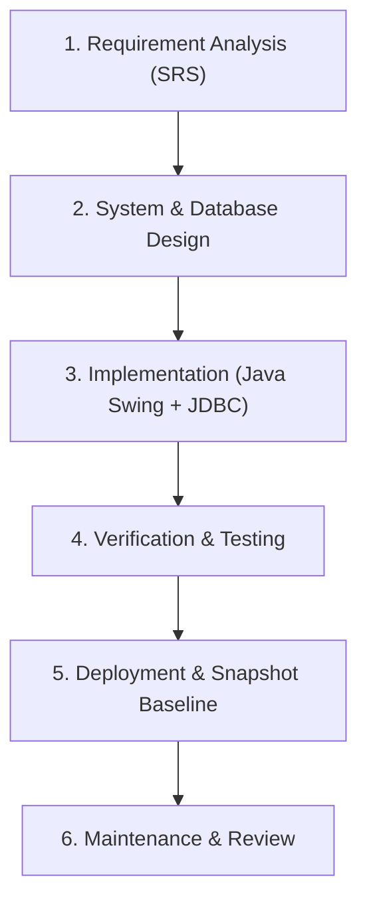

1. **Requirement Analysis (SRS):** Analyzed solar operations and maintenance workflows, identified user personas, formulated functional/non-functional criteria, and created the formal SRS document.
2. **System & Database Design:** Designed the relational database in Third Normal Form (3NF), constructed Level 0 and Level 1 Data Flow Diagrams (DFDs), and developed UML Use Case, Class, and Sequence models.
3. **Implementation:** Developed modular Java classes utilizing Java Swing for the graphical front-end, JDBC for database connectivity, and SHA-256 cryptographic hashing for credential protection.
4. **Testing:** Formulated comprehensive test cases (TC-01 to TC-15) covering authentication validation, input formatting, foreign key integrity, and CRUD operations.
5. **Deployment:** Packaged the application with Maven, initialized the relational schema, and verified GUI rendering across standard desktop resolutions.
6. **Maintenance & Review:** Documented application recovery, database backup routines, and outlined architectural paths for IoT/cloud scalability.

*Non Syllabus Project Report, Academic Year 2026-27, CS-DS, PIET, Jaipur*

---

# CHAPTER 2: REQUIREMENT ANALYSIS

Functional Requirements, Non-Functional Requirements, Product Perspective, System Product Functions, Advanced Features of the System, User Classes and Characteristics and Operating Environment have already been documented in the Software Requirement Specification (SRS) submitted earlier (SRS Ref. No.: PIET/CS-DS/2026/SRS-04, Submission Date: 15 September 2026). Please refer to that SRS; these sections are not repeated in this report.

## 2.1 Technology Used

**Table 2: Technology Used**

| Component | Details |
| :--- | :--- |
| **Programming Language** | Java (JDK 21 LTS / Java SE 21) |
| **IDE / Editor** | IntelliJ IDEA / Visual Studio Code |
| **GUI Framework** | Java Swing (`javax.swing`, `java.awt`) |
| **Database Server** | MySQL Community Server 8.0 / MariaDB 10.11+ |
| **Database Connectivity** | JDBC (`com.mysql:mysql-connector-j:9.5.0`) |
| **Build Tool** | Apache Maven 3.9+ |
| **Version Control** | Git & GitHub |

## 2.2 H/w and S/w Configuration

**Table 3: H/w and S/w Configuration**

| Requirement | Minimum Specification | Recommended Specification |
| :--- | :--- | :--- |
| **Processor** | Dual-Core Intel Core i3 / AMD equivalent (2.0 GHz) | Quad-Core Intel Core i5 / AMD Ryzen 5 (2.8 GHz+) |
| **RAM** | 4 GB DDR4 | 8 GB DDR4 or higher |
| **Hard Disk / SSD** | 500 MB free storage space | 2 GB SSD free storage space |
| **Display** | 1280 x 800 pixels resolution | 1920 x 1080 Full HD |
| **Operating System** | Windows 10/11, Ubuntu Linux 22.04 LTS, macOS | Windows 11 (64-bit) / Linux |
| **Runtime Software** | OpenJDK 21, MySQL Server 8.0 or MariaDB 10.11+ | JDK 21 LTS, MySQL Server 8.0, Maven 3.9 |

## 2.3 Graphical User Interface
The Graphical User Interface (GUI) is implemented using Java Swing and automatically adopts the host platform's native Look and Feel (`UIManager.getSystemLookAndFeelClassName()`).

1. **Authentication Screen (`LoginFrame`):** A centered dialog (430 x 260 pixels) providing credential input fields, masked password inputs via `JPasswordField`, informative setup prompts, and direct authentication against hashed database records.
2. **Main Workspace Window (`MainFrame`):** A primary container window (1100 x 700 pixels) containing a header bar displaying the active user's name and role, and a multi-tabbed workspace (`JTabbedPane`).
3. **KPI Analytics Dashboard:** Features four interactive metric cards (*Total Equipment*, *Pending Maintenance*, *Overdue Maintenance*, and *Parts Entries*), independent real-time refresh buttons, and operational workflow instructions.
4. **Data Management Panels (`DataPanel`):** Metadata-driven tabular interfaces featuring a top-mounted record entry form with dynamic input fields, action buttons (*Add Record*, *Refresh Table*, *Delete Selected*), and a scrollable `JTable` rendering database records.

## 2.4 Advantages
- **Centralized Solar Equipment Records:** Consolidates technical specifications, equipment codes, field locations, and operational statuses into an accessible database.
- **Preventive SLA Protection:** Identifies pending and overdue maintenance tasks automatically by evaluating completion deadlines against the system date (`due_date < CURDATE()`).
- **Data Security and SQL Injection Prevention:** Employs parameterized `PreparedStatement` queries and one-way SHA-256 password hashing.
- **Referential Integrity Enforcement:** Foreign key relationships with `ON DELETE SET NULL` prevent orphaned maintenance logs when parent records are updated.
- **Lightweight System Footprint:** Fast application startup with minimal memory overhead compared to browser-heavy web stacks.

## 2.5 Disadvantages
- **Desktop Environment Requirement:** Requires an operating system with desktop graphical support or virtual X11 forwarding.
- **Manual Data Entry in Baseline Version:** Inspection logs, maintenance records, and part replacements require manual entry by staff rather than automatic SCADA streaming.
- **Single-Node Database Model:** Designed primarily for single-site or localized database installations without distributed multi-master replication.

## 2.6 Applications
- **Utility-Scale Solar Farms:** Tracking central inverters, string combiners, power transformers, and tracking systems across multi-megawatt facilities.
- **Commercial & Industrial (C&I) Rooftop Arrays:** Managing preventative washing schedules, roof inverter inspections, and safety disconnect testing.
- **Off-Grid Solar Microgrids:** Tracking battery energy storage systems (BESS), solar charge controllers, and backup diesel systems in remote facilities.
- **Educational and Institutional Campuses:** Facilitating transparent asset management, safety audits, and preventive servicing across institutional solar installations.

*Non Syllabus Project Report, Academic Year 2026-27, CS-DS, PIET, Jaipur*

---

# CHAPTER 3: DESIGN

## 3.1 Data Flow Diagram (DFD)

### 3.1.1 Level 0 DFD (Context Analysis Diagram)

```text
+-----------------------+              User Credentials, Equipment Profiles,           +---------------------------------+
|                       |            Schedules, Accounts                              |                                 |
|  SYSTEM ADMINISTRATOR | ----------------------------------------------------------> |                                 |
|                       | <---------------------------------------------------------- |                                 |
+-----------------------+              Auth Token, System Alerts, Status Confirmations|                                 |
                                                                                      |                                 |
+-----------------------+              Credentials, Maintenance Logs, Work Details     |              0.0                |
|   MAINTENANCE STAFF   | ----------------------------------------------------------> |   SOLAR EQUIPMENT MAINTENANCE   |
|      (TECHNICIAN)     | <---------------------------------------------------------- |         TRACKER SYSTEM          |
+-----------------------+              Assigned Tasks, Work Orders, Equipment Specs   |                                 |
                                                                                      |                                 |
+-----------------------+              Credentials, Filter Queries                    |                                 |
|   VIEWER / AUDITOR    | ----------------------------------------------------------> |                                 |
|                       | <---------------------------------------------------------- |                                 |
+-----------------------+              Plant Health Passport, KPI Reports, Logs       +---------------------------------+
```

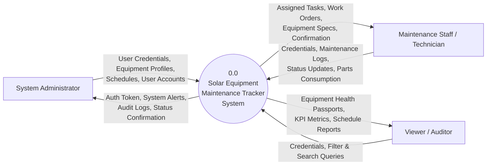

**Figure 3.1: Level 0 DFD (Context Analysis Diagram)**

#### Data Flow Descriptions:
1. **User Authentication Flow:** All users submit username and password credentials. The system verifies them against the database and establishes role-based session privileges.
2. **Asset Management Flow:** Administrators register and update solar equipment records (inverter models, array locations, installation dates, and health statuses).
3. **Maintenance Management Flow:** Maintenance technicians receive scheduled tasks, log completed service work with technical remarks, and update parts consumption records.
4. **Audit and Monitoring Flow:** Viewers and auditors query real-time equipment status metrics and historical maintenance compliance records.

---

### 3.1.2 Level 1 DFD (Decomposed System Architecture)

```text
[Entities]                 [Core Functional Processes]                           [Data Stores]
====================================================================================================
Admin/Staff/Viewer -----> (1.0 Authentication & Access Control) <=============> [D1: users]
                                    | Authorized Session
                                    +--------------------+
                                    |                    |
Admin ------------------> (2.0 Asset Management) <----------------------------> [D2: equipment]
                                    |                    |
Admin/Staff ------------> (3.0 Scheduling Module) <---------------------------> [D3: maintenance_schedule]
                                    | (reads D2, D1)     |
Staff ------------------> (4.0 Maintenance Execution) <------------------------> [D4: maintenance_record]
                                    | (reads D2, D3, D1) |
Staff/Admin ------------> (5.0 Parts & Inventory) <---------------------------> [D5: equipment_parts]
                                    | (reads D2)         |
All Users <-------------- (6.0 KPI Analytics Dashboard) <----------------------- (Aggregates D2, D3, D5)
```

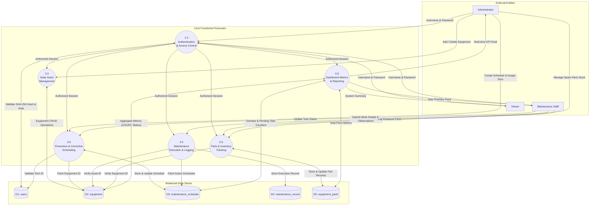

**Figure 3.2: Level 1 DFD (Detailed Functional Process Decomposition)**

---

## 3.2 ER Diagram and Database Design

### 3.2.1 Entity-Relationship (ER) Diagram

```text
+-----------------------+              1 : N (assigned to)              +--------------------------+
|         USERS         | --------------------------------------------> |   MAINTENANCE_SCHEDULE   |
|-----------------------|                                               |--------------------------|
| PK  user_id           |              1 : N (conducted by)             | PK  schedule_id          |
|     name              | --------------------+                         | FK  equipment_id         |
| UK  username          |                     |                         | FK  assigned_to          |
|     password_hash     |                     |                         |     maintenance_type     |
|     role              |                     |                         |     due_date             |
|     status            |                     |                         |     status               |
+-----------------------+                     |                         +--------------------------+
                                              |                                       |
                                              |                                       | 1 : 1 (fulfills)
                                              v                                       v
+-----------------------+              1 : N (service history)          +--------------------------+
|       EQUIPMENT       | --------------------------------------------> |    MAINTENANCE_RECORD    |
|-----------------------|                                               |--------------------------|
| PK  equipment_id      |                                               | PK  record_id            |
| UK  equipment_code    |                                               | FK  equipment_id         |
|     equipment_type    |                                               | FK  schedule_id          |
|     location          |                                               | FK  technician_id        |
|     installation_date |                                               |     maintenance_date     |
|     status            |                                               |     work_done            |
+-----------------------+                                               |     remarks              |
           |                                                            +--------------------------+
           | 1 : N (composed of)
           v
+-----------------------+
|    EQUIPMENT_PARTS    |
|-----------------------|
| PK  part_id           |
| FK  equipment_id      |
|     part_name         |
|     quantity          |
|     condition         |
+-----------------------+
```

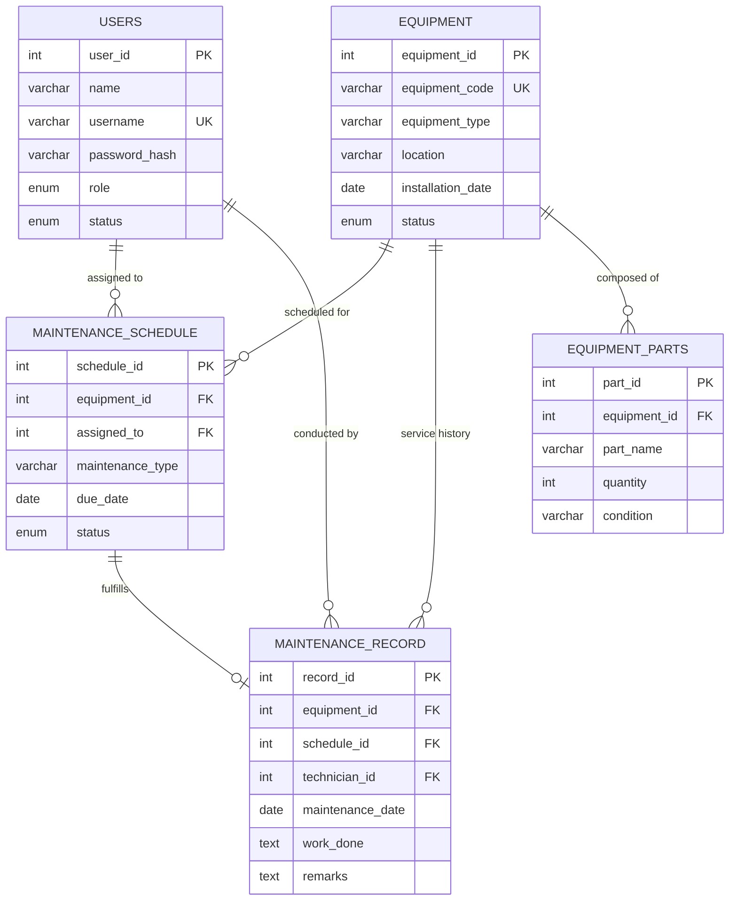

**Figure 3.3: Entity-Relationship Diagram (ERD)**

---

### 3.2.2 Database Table Structures

#### Table 4.1: Database Table Structure – `users`
*Description:* Stores user authentication credentials, full names, assigned security roles, and active life-cycle statuses.

| Field Name | Data Type | Size | Key / Constraint | Description |
| :--- | :--- | :--- | :--- | :--- |
| `user_id` | INT | 11 | PRIMARY KEY, AUTO_INCREMENT | Unique identifier for system user |
| `name` | VARCHAR | 100 | NOT NULL | Full legal name of user |
| `username` | VARCHAR | 60 | NOT NULL, UNIQUE | Unique login identifier |
| `password_hash` | VARCHAR | 64 | NOT NULL | SHA-256 cryptographic hexadecimal digest |
| `role` | ENUM | - | NOT NULL, DEFAULT 'Viewer' | 'Administrator', 'Maintenance Staff', 'Viewer' |
| `status` | ENUM | - | NOT NULL, DEFAULT 'Active' | Account life-cycle status: 'Active', 'Inactive' |

---

#### Table 4.2: Database Table Structure – `equipment`
*Description:* Catalogs physical solar field assets, hardware classifications, physical zones, installation dates, and operating statuses.

| Field Name | Data Type | Size | Key / Constraint | Description |
| :--- | :--- | :--- | :--- | :--- |
| `equipment_id` | INT | 11 | PRIMARY KEY, AUTO_INCREMENT | Unique primary key identifier |
| `equipment_code` | VARCHAR | 40 | NOT NULL, UNIQUE | Serialized barcoded identifier (e.g. 'INV-STR-001') |
| `equipment_type` | VARCHAR | 100 | NOT NULL | Equipment category (e.g. 'Central Inverter') |
| `location` | VARCHAR | 150 | NOT NULL | Physical zone (e.g. 'Array Zone B-1') |
| `installation_date` | DATE | - | NULL | Date of grid commissioning (YYYY-MM-DD) |
| `status` | ENUM | - | NOT NULL, DEFAULT 'Active' | Health state: 'Active', 'Under Maintenance', 'Inactive' |

---

#### Table 4.3: Database Table Structure – `maintenance_schedule`
*Description:* Manages scheduled preventive inspections, assigned personnel, deadlines, and execution statuses.

| Field Name | Data Type | Size | Key / Constraint | Description |
| :--- | :--- | :--- | :--- | :--- |
| `schedule_id` | INT | 11 | PRIMARY KEY, AUTO_INCREMENT | Unique maintenance task identifier |
| `equipment_id` | INT | 11 | NOT NULL, FOREIGN KEY | References `equipment(equipment_id)` |
| `assigned_to` | INT | 11 | NULL, FOREIGN KEY | References `users(user_id)` ON DELETE SET NULL |
| `maintenance_type` | VARCHAR | 100 | NOT NULL | Inspection title (e.g. 'Quarterly Inverter Inspection') |
| `due_date` | DATE | - | NOT NULL | Target deadline date (YYYY-MM-DD) |
| `status` | ENUM | - | NOT NULL, DEFAULT 'Pending' | Execution state: 'Pending', 'Completed', 'Overdue' |

---

#### Table 4.4: Database Table Structure – `maintenance_record`
*Description:* Maintains historical audit logs of executed maintenance tasks, technical notes, and observations.

| Field Name | Data Type | Size | Key / Constraint | Description |
| :--- | :--- | :--- | :--- | :--- |
| `record_id` | INT | 11 | PRIMARY KEY, AUTO_INCREMENT | Unique maintenance log identifier |
| `equipment_id` | INT | 11 | NOT NULL, FOREIGN KEY | References `equipment(equipment_id)` |
| `schedule_id` | INT | 11 | NULL, FOREIGN KEY | References `maintenance_schedule(schedule_id)` ON DELETE SET NULL |
| `technician_id` | INT | 11 | NULL, FOREIGN KEY | References `users(user_id)` ON DELETE SET NULL |
| `maintenance_date` | DATE | - | NOT NULL | Date servicing was performed (YYYY-MM-DD) |
| `work_done` | TEXT | - | NOT NULL | Detailed description of technical work performed |
| `remarks` | TEXT | - | NULL | Field diagnostic observations and notes |

---

#### Table 4.5: Database Table Structure – `equipment_parts`
*Description:* Tracks spare parts inventory, consumables, component quantities, and wear ratings allocated to solar equipment.

| Field Name | Data Type | Size | Key / Constraint | Description |
| :--- | :--- | :--- | :--- | :--- |
| `part_id` | INT | 11 | PRIMARY KEY, AUTO_INCREMENT | Unique identifier for spare part |
| `equipment_id` | INT | 11 | NOT NULL, FOREIGN KEY | References `equipment(equipment_id)` |
| `part_name` | VARCHAR | 100 | NOT NULL | Part description (e.g. '1000V DC Fuse 15A') |
| `quantity` | INT | 11 | NOT NULL, DEFAULT 0 | Count of available/installed units |
| `condition` | VARCHAR | 60 | NOT NULL, DEFAULT 'Good' | Operational rating: 'Good', 'Worn', 'Needs Replacement' |

---

## 3.3 Unified Modelling Language (UML)

### 3.3.1 UML Use Case Diagram

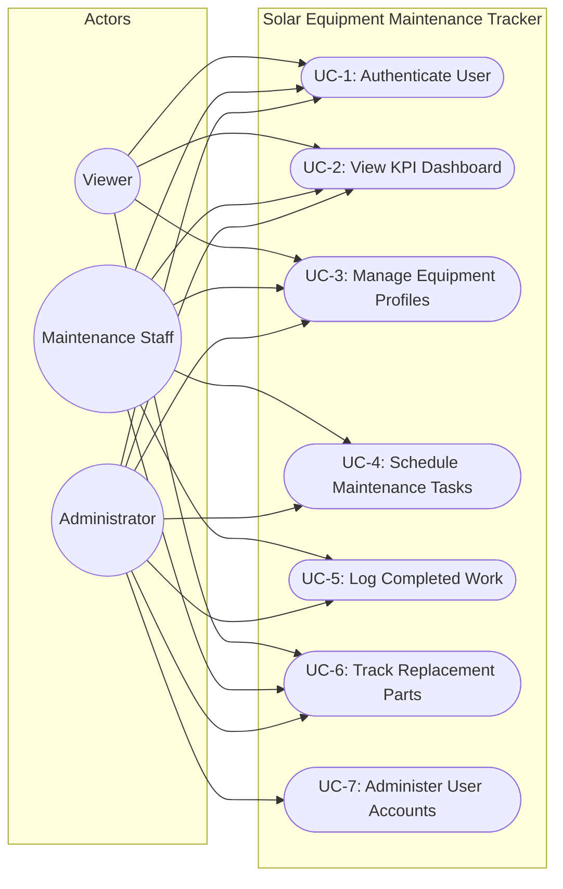

**Figure 3.4: UML Use Case Diagram**

The Use Case Diagram defines interactions between the three system actors and functional features:
- **Administrator:** Exercises complete access across all use cases (UC-1 to UC-7), including user provisioning and administrative deletions.
- **Maintenance Staff:** Authorized for authentication (UC-1), dashboard overview (UC-2), equipment records (UC-3), task scheduling (UC-4), maintenance execution logging (UC-5), and spare parts tracking (UC-6).
- **Viewer:** Permitted read-only inspection of dashboards, equipment catalogs, and replacement parts.

---

### 3.3.2 UML Class Diagram

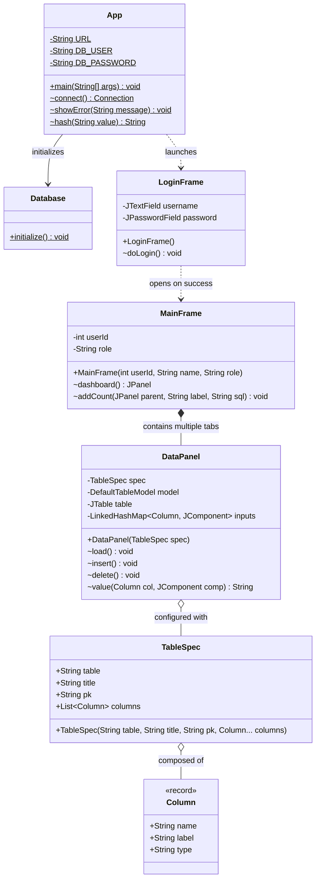

**Figure 3.5: UML Class Diagram**

The Class Diagram illustrates the architectural relationships among the core application components:
- `App` manages central static factories (`connect()`, `hash()`, `showError()`).
- `Database` handles schema migration and administrative seed records.
- `LoginFrame` initiates credential evaluation.
- `MainFrame` acts as the primary layout coordinator, managing tabs based on user privileges.
- `DataPanel` dynamically binds metadata from `TableSpec` and `Column` records into Swing forms and tables.

---

### 3.3.3 UML Sequence Diagrams

#### Sequence Diagram 1: User Authentication Flow

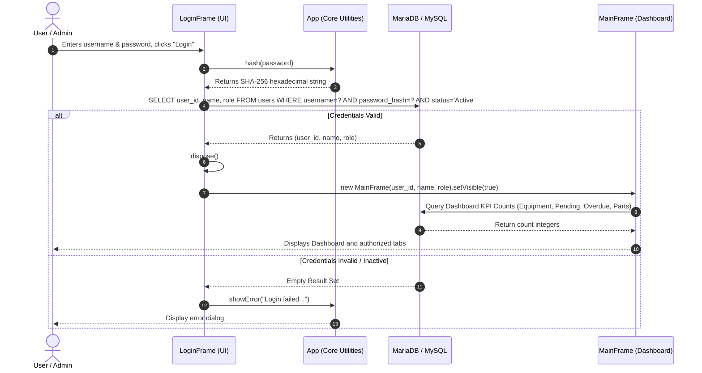

**Figure 3.6: UML Sequence Diagram – Authentication & Workspace Initialization**

---

#### Sequence Diagram 2: Maintenance Schedule Creation Flow

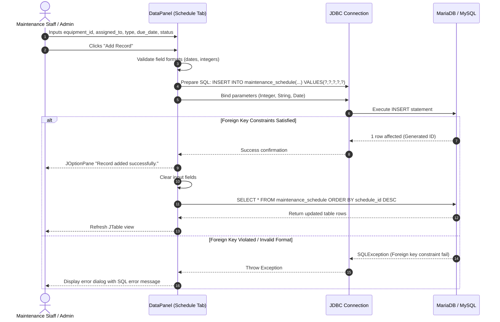

**Figure 3.7: UML Sequence Diagram – Preventive Maintenance Task Scheduling**

*Non Syllabus Project Report, Academic Year 2026-27, CS-DS, PIET, Jaipur*

---

# CHAPTER 4: IMPLEMENTATION AND TESTING (JAVA)

## 4.1 Project Structure (Packages and Classes)

The project adheres to the standard Apache Maven directory structure:

```text
solar-maintenance-tracker/
├── pom.xml                                   # Project Object Model dependencies and compiler settings
├── README.md                                 # Application usage and deployment documentation
├── schema.sql                                # DDL database creation script
├── run.bat                                   # Windows automated execution script
├── start_gui.sh                              # Linux virtual display and GUI launcher
├── snapshots/                                # Project graphical execution snapshots
│   ├── 01_login_screen.png
│   ├── 02_dashboard_kpi.png
│   ├── 03_equipment_tab.png
│   ├── 04_maintenance_schedule_tab.png
│   ├── 05_maintenance_records_tab.png
│   ├── 06_equipment_parts_tab.png
│   └── 07_users_tab.png
└── src/
    └── main/
        └── java/
            └── com/
                └── piet/
                    └── solar/
                        ├── App.java          # Core application & GUI entry point
                        └── CaptureSnapshots.java # Programmatic snapshot suite
```

### Purpose of Core Classes:
1. **`com.piet.solar.App`**: Main entry class. Manages runtime database configuration, the static connection factory `connect()`, error modal utilities `showError()`, and the SHA-256 cryptographic hashing helper `hash()`.
2. **`com.piet.solar.App.Database`**: Auto-migration manager. Connects to the database on startup, executes `CREATE TABLE IF NOT EXISTS` DDL statements for all entities, and seeds the default administrator account.
3. **`com.piet.solar.App.LoginFrame`**: Authentication window. Provides input controls, executes parameterized queries against `users`, and launches the main workspace.
4. **`com.piet.solar.App.MainFrame`**: Primary workspace shell. Configures window layout, role-based tab visibility, and real-time KPI card layout.
5. **`com.piet.solar.App.DataPanel`**: Generic metadata-driven CRUD panel. Dynamically builds input forms, handles data binding, and coordinates insert, delete, and reload operations for any entity.
6. **`com.piet.solar.App.TableSpec`**: Metadata carrier specifying table name, title, primary key, and column definitions.
7. **`com.piet.solar.App.Column`**: Java 21 record defining column names, UI labels, and data types (`text`, `number`, `nullableNumber`, `date`, `password`).

---

## 4.2 Modules Description

1. **Authentication & Access Control Module:**
   - *Classes / Methods:* `App.LoginFrame.doLogin()`, `App.hash()`, `App.connect()`
   - *Description:* Validates user credentials using SHA-256 password hashing. On successful verification, it passes session identity (`userId`, `name`, `role`) to `MainFrame` and renders permitted tabs based on role privileges.
2. **Executive KPI Dashboard & Plant Health Module:**
   - *Classes / Methods:* `App.MainFrame.dashboard()`, `App.MainFrame.addCount()`
   - *Description:* Displays real-time operational metric cards for Total Equipment, Pending Tasks, Overdue Maintenance (`due_date < CURDATE()`), and Spare Parts Entries, equipped with independent refresh buttons and workflow documentation.
3. **Solar Asset Management Module:**
   - *Classes / Methods:* `App.DataPanel.load()`, `insert()`, `delete()`
   - *Description:* Manages solar equipment inventories, tracking equipment codes, types, field locations, installation dates, and health statuses (`Active`, `Under Maintenance`, `Inactive`).
4. **Preventive Maintenance Scheduling Module:**
   - *Classes / Methods:* `App.DataPanel` configured with `maintenance_schedule` spec
   - *Description:* Manages scheduled service tasks, assigning technicians, setting due dates, and tracking status compliance (`Pending`, `Completed`, `Overdue`).
5. **Maintenance Work Execution & Audit Log Module:**
   - *Classes / Methods:* `App.DataPanel` configured with `maintenance_record` spec
   - *Description:* Captures permanent servicing logs, recording work performed, maintenance dates, and technician observations.
6. **Spare Parts Inventory & Health Tracking Module:**
   - *Classes / Methods:* `App.DataPanel` configured with `equipment_parts` spec
   - *Description:* Manages spare component inventories linked to parent equipment assets, tracking quantities and physical conditions (`Good`, `Worn`, `Needs Replacement`).
7. **User Administration Module (Administrator Only):**
   - *Classes / Methods:* `App.MainFrame`, `App.DataPanel` (`users` spec), `App.hash()`
   - *Description:* Restricted to administrators. Manages user provisioning, role assignments (`Administrator`, `Maintenance Staff`, `Viewer`), account status toggling, and password hashing on account creation.

---

## 4.3 Database Connectivity (JDBC)

Database connectivity is managed through the MySQL Connector/J driver (`com.mysql:mysql-connector-j:9.5.0`). The system reads configuration from environment variables with fallback defaults:

```java
// Database Connection Specification in com.piet.solar.App
private static final String URL = System.getenv().getOrDefault(
    "SOLAR_DB_URL",
    "jdbc:mysql://localhost:3306/solar_maintenance?serverTimezone=UTC&useSSL=false&allowPublicKeyRetrieval=true"
);
private static final String DB_USER = System.getenv().getOrDefault("SOLAR_DB_USER", "root");
private static final String DB_PASSWORD = System.getenv().getOrDefault("SOLAR_DB_PASSWORD", "");

static Connection connect() throws SQLException {
    return DriverManager.getConnection(URL, DB_USER, DB_PASSWORD);
}
```

### Query Execution Practices:
1. **Parameterized Queries (`PreparedStatement`):** All SQL statements use `PreparedStatement` with typed parameter binding to prevent SQL injection vulnerabilities.
2. **Deterministic Cryptographic Hashing:** Passwords are converted to 256-bit SHA-256 hexadecimal digests before database comparison or insertion.
3. **Resource Management:** All database operations utilize Java `try-with-resources` blocks to ensure `Connection`, `Statement`, and `ResultSet` objects are closed automatically.

---

## 4.4 Testing

The system was verified across functional, integration, boundary, and foreign key constraint scenarios.

**Table 5: Test Cases**

| TC ID | Module | Test Description | Input Data | Expected Output | Actual Output | Status |
| :--- | :--- | :--- | :--- | :--- | :--- | :---: |
| **TC-01** | Auth | Valid administrator login | User: `admin`, Pass: `admin123` | Login succeeds; `MainFrame` opens with all tabs | Login successful; Admin dashboard displayed | **PASSED** |
| **TC-02** | Auth | Invalid password attempt | User: `admin`, Pass: `wrongpass` | Error dialog: "Login failed. Check username/password..." | Error dialog displayed; access denied | **PASSED** |
| **TC-03** | Auth | Non-existent username | User: `unknown_user`, Pass: `any` | Error dialog: "Login failed. Check username/password..." | Error dialog displayed; access denied | **PASSED** |
| **TC-04** | Auth | Inactive account login | User: `inactive_user`, Pass: `pass123` (status='Inactive') | Error dialog: "Login failed... ensure user is Active" | Error dialog displayed; access denied | **PASSED** |
| **TC-05** | Auth | Non-admin role visibility | User: `tech1`, Pass: `pass123` (role='Maintenance Staff') | `MainFrame` opens without the "Users" administration tab | Users tab hidden; only operational tabs visible | **PASSED** |
| **TC-06** | Asset | Valid equipment entry | Code: `INV-STR-001`, Type: `Central Inverter`, Loc: `Zone B-1`, Date: `2025-03-10`, Status: `Active` | "Record added successfully"; row appears in table | Record persisted and visible in JTable | **PASSED** |
| **TC-07** | Asset | Duplicate equipment code | Code: `INV-STR-001` (already exists) | Error modal indicating unique constraint violation | Duplicate entry error caught and displayed | **PASSED** |
| **TC-08** | Asset | Invalid date format in asset | Date: `10-03-2025` (non-ISO format) | Error modal: "Check required fields, date format..." | Handled by date parser; error shown | **PASSED** |
| **TC-09** | Schedule | Valid maintenance schedule | Eq ID: `1`, Assigned: `3`, Type: `Inspection`, Due: `2026-11-15`, Status: `Pending` | "Record added successfully"; KPI counter increments | Record added; Pending counter increments | **PASSED** |
| **TC-10** | Schedule | Non-existent Equipment ID | Eq ID: `99999` (does not exist in `equipment`) | Foreign key violation error handled gracefully | Foreign key constraint error modal shown | **PASSED** |
| **TC-11** | Schedule | Optional technician left blank | Eq ID: `1`, Assigned: `""` (blank), Type: `Cleaning`, Due: `2026-12-01`, Status: `Pending` | Database accepts `NULL` for `assigned_to` | Record saved with `assigned_to = NULL` | **PASSED** |
| **TC-12** | Records | Valid maintenance record entry | Eq ID: `1`, Sched ID: `4`, Tech ID: `3`, Date: `2026-08-15`, Work: `Replaced fuse`, Remarks: `Tested OK` | "Record added successfully"; audit log updated | Log saved in table | **PASSED** |
| **TC-13** | Parts | Valid spare part entry | Eq ID: `1`, Part: `1000V DC Fuse 15A`, Qty: `12`, Condition: `Good` | Part registered under equipment ID 1 | Record saved; Parts count incremented | **PASSED** |
| **TC-14** | Parts | Non-numeric quantity in parts | Eq ID: `1`, Part: `Fuse`, Qty: `abc`, Condition: `Good` | Parsing exception caught; user prompted to correct | Error modal shown: integer parse failure | **PASSED** |
| **TC-15** | CRUD | Delete selected record | Select row in table and click "Delete Selected" | Confirmation dialog shown; record removed on "Yes" | Row deleted from DB and JTable reloads | **PASSED** |

*Non Syllabus Project Report, Academic Year 2026-27, CS-DS, PIET, Jaipur*

---

# CHAPTER 5: CONCLUSION AND FUTURE SCOPE

## 5.1 Conclusion
The **Solar Equipment Maintenance Tracker** delivers a dependable, normalized data management platform tailored for solar field operations. By replacing error-prone manual spreadsheets and paper logbooks with a structured Java Swing desktop application and MySQL/MariaDB database, the project achieves:
1. **Operational Traceability:** Every preventive schedule and completed maintenance activity is mapped to verified equipment identifiers and technician user accounts.
2. **Enhanced Decision Support:** The executive dashboard provides instant visibility into total assets, pending servicing tasks, overdue maintenance items, and replacement parts inventory.
3. **Relational Data Integrity:** Built upon a 3NF relational schema enforcing foreign key dependencies (`ON DELETE SET NULL`), preventing orphaned records.
4. **Cryptographic Protection:** Protects stored credentials using deterministic SHA-256 cryptographic hashing and enforces role-based authorization.

## 5.2 Future Scope
1. **IoT Sensor & SCADA Telemetry Ingestion:** Integrating Modbus TCP and MQTT protocols to capture real-time inverter temperatures, string DC currents, and pyranometer irradiance readings directly into the database.
2. **Predictive Maintenance using Machine Learning:** Developing predictive models using historical maintenance records to forecast inverter capacitor failure rates and solar panel soiling degradation.
3. **Automated Export & Compliance Reporting:** Implementing automated generation of compliance reports in PDF and CSV formats for site owners and regulatory agencies.
4. **Mobile Field Companion:** Developing a companion mobile application (Android/PWA) enabling field technicians to scan equipment QR codes and log repairs directly from array field rows.

*Non Syllabus Project Report, Academic Year 2026-27, CS-DS, PIET, Jaipur*

---

# CHAPTER 6: REFERENCES

[1] J. Gosling, B. Joy, G. L. Steele, G. Bracha, and A. Buckley, *The Java Language Specification, Java SE 21 Edition*, Oracle Corporation, 2023.

[2] Oracle Corporation, *Java Platform, Standard Edition & Java Development Kit Version 21 API Specification*, Oracle Docs, 2023. [Online]. Available: https://docs.oracle.com/en/java/javase/21/

[3] MySQL AB, *MySQL 8.0 Reference Manual*, Oracle Corporation, 2024. [Online]. Available: https://dev.mysql.com/doc/refman/8.0/en/

[4] B. Eckel, *Thinking in Java*, 4th ed., Prentice Hall, Upper Saddle River, NJ, 2006.

[5] C. J. Date, *An Introduction to Database Systems*, 8th ed., Pearson Education, 2004.

[6] International Renewable Energy Agency (IRENA), *Operation and Maintenance of Photovoltaic Systems: Best Practices*, IRENA Reports, Abu Dhabi, 2020.

[7] R. S. Pressman and B. R. Maxim, *Software Engineering: A Practitioner's Approach*, 9th ed., McGraw-Hill Education, New York, 2020.

*Non Syllabus Project Report, Academic Year 2026-27, CS-DS, PIET, Jaipur*

---

# CHAPTER 7: SNAPSHOTS OF PROJECT

This chapter presents authentic screenshots of the Solar Equipment Maintenance Tracker captured directly from the live application environment.

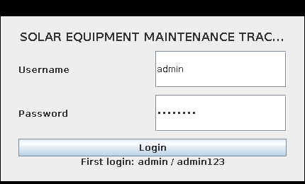

**Figure 7.1: Authentication Screen (`LoginFrame`)**  
*The secure authentication gateway featuring credential input fields, masked password inputs, default credential guidance, and SHA-256 hash verification.*

---

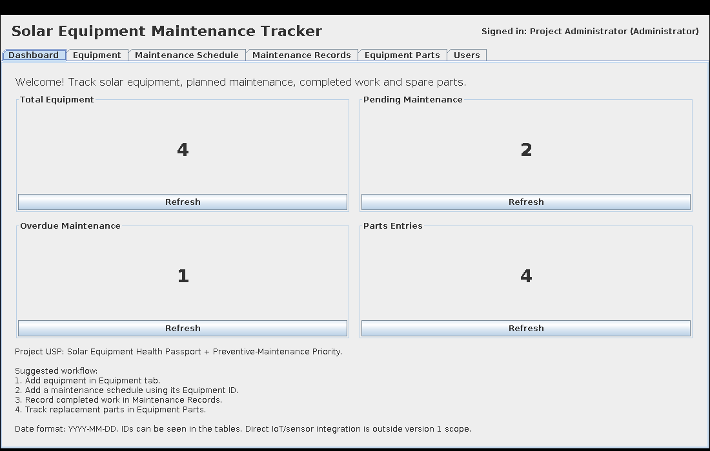

**Figure 7.2: Executive KPI Dashboard & Equipment Health Passport Overview**  
*The central executive workspace displaying real-time operational metric cards (Total Equipment, Pending Maintenance, Overdue Maintenance, and Parts Entries) with refresh triggers and procedural workflow instructions.*

---

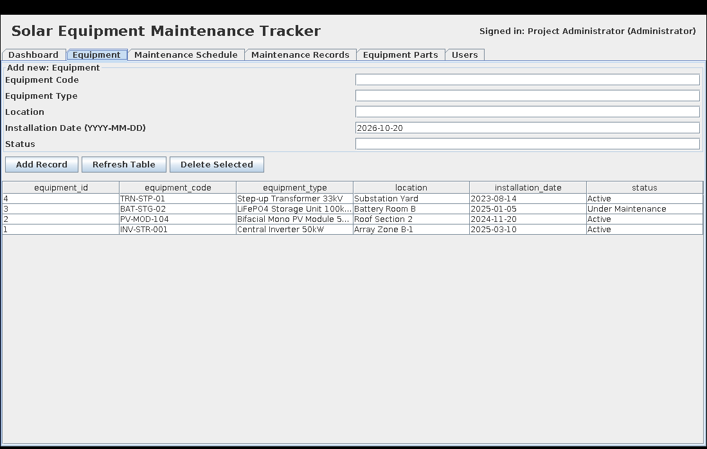

**Figure 7.3: Solar Asset Registry Interface (`equipment` panel)**  
*The equipment management interface displaying registered solar assets, equipment categories, field location tags, commissioning dates, and operational statuses.*

---

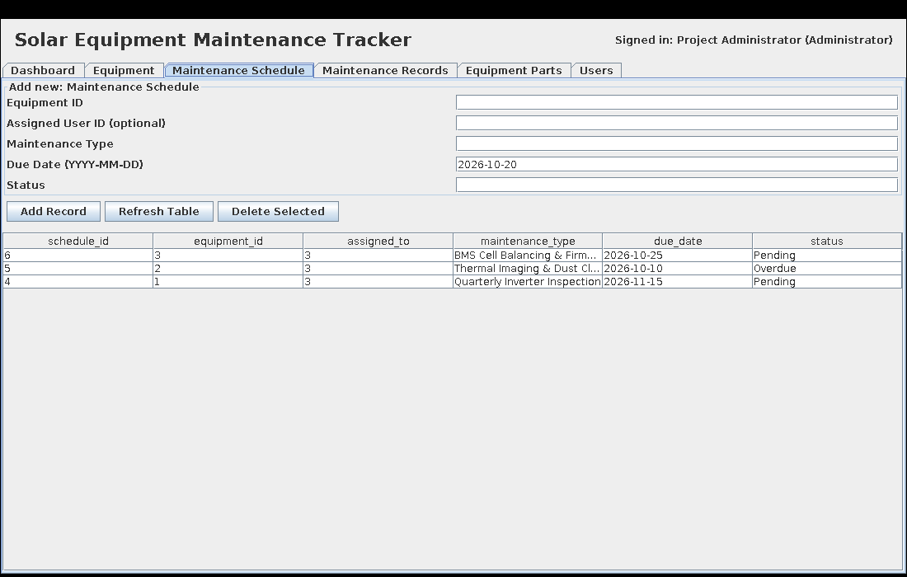

**Figure 7.4: Preventive Maintenance Task Scheduler (`maintenance_schedule` panel)**  
*The maintenance scheduling interface enabling creation of preventive service tasks, technician assignment, due-date configuration, and task status tracking.*

---

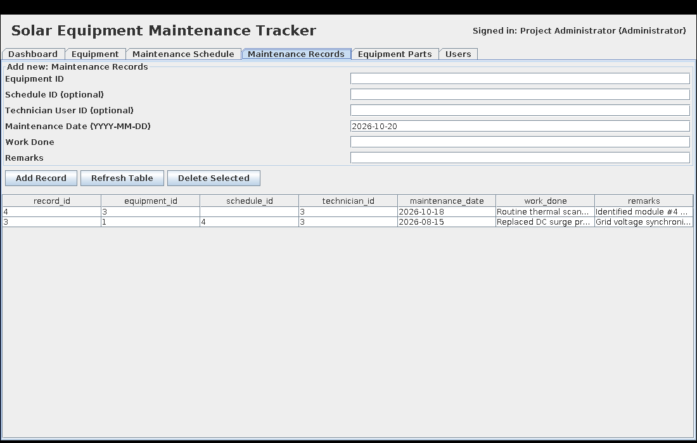

**Figure 7.5: Maintenance Work Execution Log (`maintenance_record` panel)**  
*The maintenance execution log recording completed servicing work, technician sign-offs, execution dates, and field diagnostic remarks.*

---

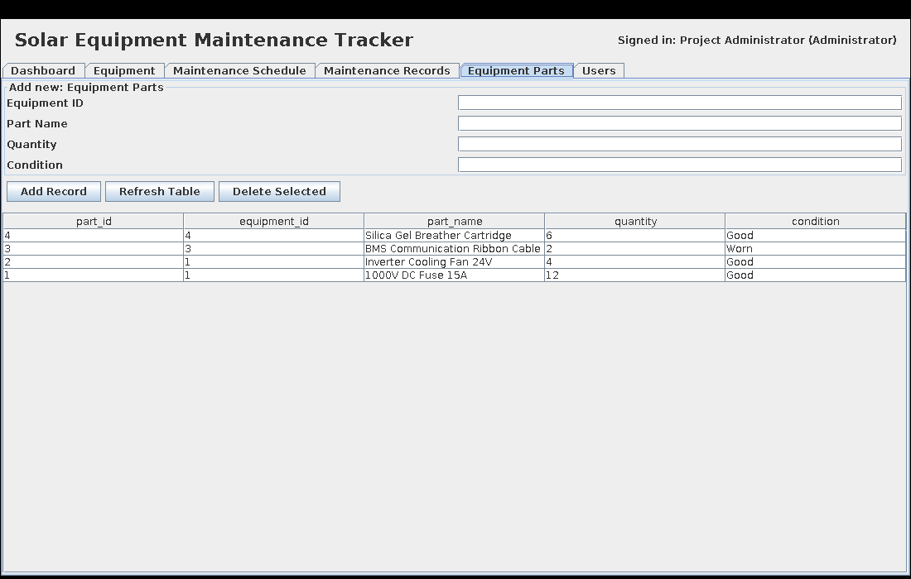

**Figure 7.6: Spare Parts Inventory & Health Tracking (`equipment_parts` panel)**  
*The spare parts tracking interface managing component stock, associated equipment IDs, quantities, and physical condition assessments.*

---

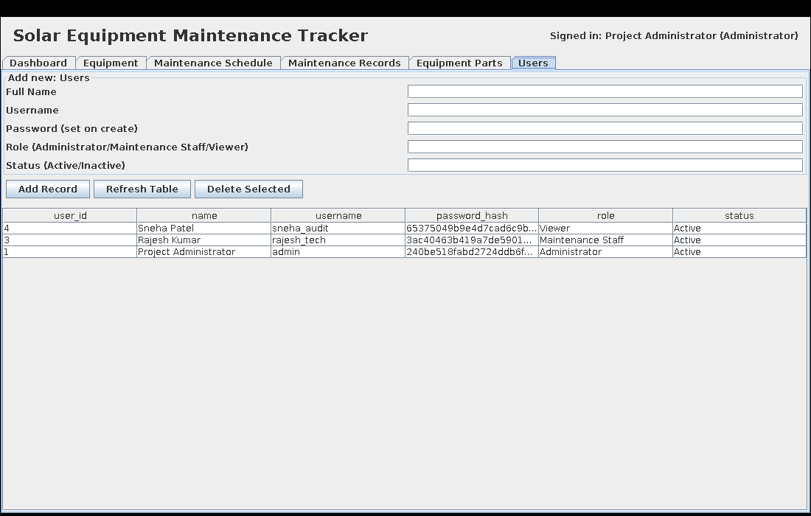

**Figure 7.7: User Administration & Role Provisioning (`users` panel)**  
*The administrator-only security management interface for provisioning user accounts, setting role permissions, and updating account life-cycle statuses.*

*Non Syllabus Project Report, Academic Year 2026-27, CS-DS, PIET, Jaipur*

---

# CHAPTER 8: CODE OF PROJECT

**File: `com/piet/solar/App.java`**

```java
package com.piet.solar;

import javax.swing.*;
import javax.swing.table.DefaultTableModel;
import java.awt.*;
import java.nio.charset.StandardCharsets;
import java.security.MessageDigest;
import java.sql.*;
import java.time.LocalDate;
import java.util.*;

/**
 * Solar Equipment Maintenance Tracker
 * Academic Non-Syllabus Project (CS-DS, PIET Jaipur, 2026-27)
 */
public class App {
    private static final String URL = System.getenv().getOrDefault(
        "SOLAR_DB_URL",
        "jdbc:mysql://localhost:3306/solar_maintenance?serverTimezone=UTC&useSSL=false&allowPublicKeyRetrieval=true"
    );
    private static final String DB_USER = System.getenv().getOrDefault("SOLAR_DB_USER", "root");
    private static final String DB_PASSWORD = System.getenv().getOrDefault("SOLAR_DB_PASSWORD", "");

    public static void main(String[] args) {
        SwingUtilities.invokeLater(() -> {
            try {
                UIManager.setLookAndFeel(UIManager.getSystemLookAndFeelClassName());
                Database.initialize();
                new LoginFrame().setVisible(true);
            } catch (Exception ex) {
                showError("Could not initialize the database. Check MySQL and DB settings.\n\n" + ex.getMessage());
            }
        });
    }

    static Connection connect() throws SQLException {
        return DriverManager.getConnection(URL, DB_USER, DB_PASSWORD);
    }
    
    static void showError(String message) {
        JOptionPane.showMessageDialog(null, message, "Solar Maintenance Tracker", JOptionPane.ERROR_MESSAGE);
    }
    
    static String hash(String value) throws Exception {
        byte[] bytes = MessageDigest.getInstance("SHA-256").digest(value.getBytes(StandardCharsets.UTF_8));
        return HexFormat.of().formatHex(bytes);
    }

    static class Database {
        static void initialize() throws Exception {
            try (Connection c = connect(); Statement s = c.createStatement()) {
                s.executeUpdate(
                    "CREATE TABLE IF NOT EXISTS users (" +
                    "user_id INT AUTO_INCREMENT PRIMARY KEY, " +
                    "name VARCHAR(100) NOT NULL, " +
                    "username VARCHAR(60) NOT NULL UNIQUE, " +
                    "password_hash VARCHAR(64) NOT NULL, " +
                    "role ENUM('Administrator','Maintenance Staff','Viewer') NOT NULL DEFAULT 'Viewer', " +
                    "status ENUM('Active','Inactive') NOT NULL DEFAULT 'Active')"
                );
                s.executeUpdate(
                    "CREATE TABLE IF NOT EXISTS equipment (" +
                    "equipment_id INT AUTO_INCREMENT PRIMARY KEY, " +
                    "equipment_code VARCHAR(40) NOT NULL UNIQUE, " +
                    "equipment_type VARCHAR(100) NOT NULL, " +
                    "location VARCHAR(150) NOT NULL, " +
                    "installation_date DATE NULL, " +
                    "status ENUM('Active','Under Maintenance','Inactive') NOT NULL DEFAULT 'Active')"
                );
                s.executeUpdate(
                    "CREATE TABLE IF NOT EXISTS maintenance_schedule (" +
                    "schedule_id INT AUTO_INCREMENT PRIMARY KEY, " +
                    "equipment_id INT NOT NULL, " +
                    "assigned_to INT NULL, " +
                    "maintenance_type VARCHAR(100) NOT NULL, " +
                    "due_date DATE NOT NULL, " +
                    "status ENUM('Pending','Completed','Overdue') NOT NULL DEFAULT 'Pending', " +
                    "CONSTRAINT fk_schedule_equipment FOREIGN KEY (equipment_id) REFERENCES equipment(equipment_id), " +
                    "CONSTRAINT fk_schedule_user FOREIGN KEY (assigned_to) REFERENCES users(user_id) ON DELETE SET NULL)"
                );
                s.executeUpdate(
                    "CREATE TABLE IF NOT EXISTS maintenance_record (" +
                    "record_id INT AUTO_INCREMENT PRIMARY KEY, " +
                    "equipment_id INT NOT NULL, " +
                    "schedule_id INT NULL, " +
                    "technician_id INT NULL, " +
                    "maintenance_date DATE NOT NULL, " +
                    "work_done TEXT NOT NULL, " +
                    "remarks TEXT, " +
                    "CONSTRAINT fk_record_equipment FOREIGN KEY (equipment_id) REFERENCES equipment(equipment_id), " +
                    "CONSTRAINT fk_record_schedule FOREIGN KEY (schedule_id) REFERENCES maintenance_schedule(schedule_id) ON DELETE SET NULL, " +
                    "CONSTRAINT fk_record_technician FOREIGN KEY (technician_id) REFERENCES users(user_id) ON DELETE SET NULL)"
                );
                s.executeUpdate(
                    "CREATE TABLE IF NOT EXISTS equipment_parts (" +
                    "part_id INT AUTO_INCREMENT PRIMARY KEY, " +
                    "equipment_id INT NOT NULL, " +
                    "part_name VARCHAR(100) NOT NULL, " +
                    "quantity INT NOT NULL DEFAULT 0, " +
                    "`condition` VARCHAR(60) NOT NULL DEFAULT 'Good', " +
                    "CONSTRAINT fk_parts_equipment FOREIGN KEY (equipment_id) REFERENCES equipment(equipment_id))"
                );
                try (PreparedStatement p = c.prepareStatement(
                    "INSERT IGNORE INTO users(name,username,password_hash,role,status) VALUES(?,?,?,?, 'Active')"
                )) {
                    p.setString(1, "Project Administrator");
                    p.setString(2, "admin");
                    p.setString(3, hash("admin123"));
                    p.setString(4, "Administrator");
                    p.executeUpdate();
                }
            }
        }
    }

    static class LoginFrame extends JFrame {
        JTextField username = new JTextField("admin", 18);
        JPasswordField password = new JPasswordField("admin123", 18);
        
        LoginFrame() {
            setTitle("Solar Equipment Maintenance Tracker - Login");
            setDefaultCloseOperation(EXIT_ON_CLOSE);
            setSize(430, 260);
            setLocationRelativeTo(null);
            JPanel root = new JPanel(new BorderLayout(10,10));
            root.setBorder(BorderFactory.createEmptyBorder(20,25,20,25));
            JLabel title = new JLabel("SOLAR EQUIPMENT MAINTENANCE TRACKER", SwingConstants.CENTER);
            title.setFont(new Font("Arial", Font.BOLD, 16));
            JPanel form = new JPanel(new GridLayout(2,2,8,10));
            form.add(new JLabel("Username")); form.add(username);
            form.add(new JLabel("Password")); form.add(password);
            JButton login = new JButton("Login");
            login.addActionListener(e -> doLogin());
            password.addActionListener(e -> doLogin());
            JLabel hint = new JLabel("First login: admin / admin123", SwingConstants.CENTER);
            root.add(title, BorderLayout.NORTH);
            root.add(form, BorderLayout.CENTER);
            JPanel bottom = new JPanel(new BorderLayout());
            bottom.add(login, BorderLayout.NORTH);
            bottom.add(hint, BorderLayout.SOUTH);
            root.add(bottom, BorderLayout.SOUTH);
            setContentPane(root);
        }
        
        void doLogin() {
            try (Connection c = connect();
                 PreparedStatement p = c.prepareStatement(
                     "SELECT user_id,name,role FROM users WHERE username=? AND password_hash=? AND status='Active'"
                 )) {
                p.setString(1, username.getText().trim());
                p.setString(2, hash(new String(password.getPassword())));
                try (ResultSet r = p.executeQuery()) {
                    if (r.next()) {
                        int id = r.getInt("user_id");
                        String name = r.getString("name"), role = r.getString("role");
                        dispose();
                        new MainFrame(id, name, role).setVisible(true);
                    } else {
                        showError("Login failed. Check username/password and ensure the user is Active.");
                    }
                }
            } catch (Exception ex) {
                showError(ex.getMessage());
            }
        }
    }

    record Column(String name, String label, String type) {}
    
    static class TableSpec {
        final String table, title, pk;
        final java.util.List<Column> columns;
        TableSpec(String table, String title, String pk, Column... columns) {
            this.table = table; this.title = title; this.pk = pk;
            this.columns = java.util.List.of(columns);
        }
    }

    static class MainFrame extends JFrame {
        final int userId;
        final String role;
        
        MainFrame(int userId, String name, String role) {
            this.userId = userId;
            this.role = role;
            setTitle("Solar Equipment Maintenance Tracker");
            setDefaultCloseOperation(EXIT_ON_CLOSE);
            setSize(1100, 700);
            setLocationRelativeTo(null);
            JPanel top = new JPanel(new BorderLayout());
            top.setBorder(BorderFactory.createEmptyBorder(12,16,12,16));
            JLabel heading = new JLabel("Solar Equipment Maintenance Tracker");
            heading.setFont(new Font("Arial", Font.BOLD, 22));
            top.add(heading, BorderLayout.WEST);
            top.add(new JLabel("Signed in: " + name + " (" + role + ")"), BorderLayout.EAST);
            add(top, BorderLayout.NORTH);
            
            JTabbedPane tabs = new JTabbedPane();
            tabs.addTab("Dashboard", dashboard());
            tabs.addTab("Equipment", new DataPanel(new TableSpec(
                "equipment","Equipment","equipment_id",
                new Column("equipment_code","Equipment Code","text"),
                new Column("equipment_type","Equipment Type","text"),
                new Column("location","Location","text"),
                new Column("installation_date","Installation Date (YYYY-MM-DD)","date"),
                new Column("status","Status","text")
            )));
            tabs.addTab("Maintenance Schedule", new DataPanel(new TableSpec(
                "maintenance_schedule","Maintenance Schedule","schedule_id",
                new Column("equipment_id","Equipment ID","number"),
                new Column("assigned_to","Assigned User ID (optional)","nullableNumber"),
                new Column("maintenance_type","Maintenance Type","text"),
                new Column("due_date","Due Date (YYYY-MM-DD)","date"),
                new Column("status","Status","text")
            )));
            tabs.addTab("Maintenance Records", new DataPanel(new TableSpec(
                "maintenance_record","Maintenance Records","record_id",
                new Column("equipment_id","Equipment ID","number"),
                new Column("schedule_id","Schedule ID (optional)","nullableNumber"),
                new Column("technician_id","Technician User ID (optional)","nullableNumber"),
                new Column("maintenance_date","Maintenance Date (YYYY-MM-DD)","date"),
                new Column("work_done","Work Done","text"),
                new Column("remarks","Remarks","text")
            )));
            tabs.addTab("Equipment Parts", new DataPanel(new TableSpec(
                "equipment_parts","Equipment Parts","part_id",
                new Column("equipment_id","Equipment ID","number"),
                new Column("part_name","Part Name","text"),
                new Column("quantity","Quantity","number"),
                new Column("condition","Condition","text")
            )));
            if ("Administrator".equals(role)) {
                tabs.addTab("Users", new DataPanel(new TableSpec(
                    "users","Users","user_id",
                    new Column("name","Full Name","text"),
                    new Column("username","Username","text"),
                    new Column("password_hash","Password (set on create)","password"),
                    new Column("role","Role (Administrator/Maintenance Staff/Viewer)","text"),
                    new Column("status","Status (Active/Inactive)","text")
                )));
            }
            add(tabs, BorderLayout.CENTER);
        }
        
        JPanel dashboard() {
            JPanel p = new JPanel(new BorderLayout(10,10));
            p.setBorder(BorderFactory.createEmptyBorder(20,20,20,20));
            JLabel welcome = new JLabel("Welcome! Track solar equipment, planned maintenance, completed work and spare parts.");
            welcome.setFont(new Font("Arial", Font.PLAIN, 16));
            p.add(welcome, BorderLayout.NORTH);
            JPanel cards = new JPanel(new GridLayout(2,2,12,12));
            addCount(cards, "Total Equipment", "SELECT COUNT(*) FROM equipment");
            addCount(cards, "Pending Maintenance", "SELECT COUNT(*) FROM maintenance_schedule WHERE status='Pending'");
            addCount(cards, "Overdue Maintenance", "SELECT COUNT(*) FROM maintenance_schedule WHERE status='Overdue' OR (status='Pending' AND due_date<CURDATE())");
            addCount(cards, "Parts Entries", "SELECT COUNT(*) FROM equipment_parts");
            p.add(cards, BorderLayout.CENTER);
            JTextArea note = new JTextArea(
                "Project USP: Solar Equipment Health Passport + Preventive-Maintenance Priority.\n\n" +
                "Suggested workflow:\n" +
                "1. Add equipment in Equipment tab.\n" +
                "2. Add a maintenance schedule using its Equipment ID.\n" +
                "3. Record completed work in Maintenance Records.\n" +
                "4. Track replacement parts in Equipment Parts.\n\n" +
                "Date format: YYYY-MM-DD. IDs can be seen in the tables. Direct IoT/sensor integration is outside version 1 scope."
            );
            note.setEditable(false);
            note.setBackground(p.getBackground());
            p.add(note, BorderLayout.SOUTH);
            return p;
        }
        
        void addCount(JPanel parent, String label, String sql) {
            JPanel card = new JPanel(new BorderLayout());
            card.setBorder(BorderFactory.createTitledBorder(label));
            JLabel value = new JLabel("—", SwingConstants.CENTER);
            value.setFont(new Font("Arial", Font.BOLD, 28));
            card.add(value);
            JButton refresh = new JButton("Refresh");
            refresh.addActionListener(e -> {
                try (Connection c = connect(); Statement s = c.createStatement(); ResultSet r = s.executeQuery(sql)) {
                    r.next();
                    value.setText(r.getString(1));
                } catch (Exception ex) {
                    showError(ex.getMessage());
                }
            });
            refresh.doClick();
            card.add(refresh, BorderLayout.SOUTH);
            parent.add(card);
        }
    }

    static class DataPanel extends JPanel {
        final TableSpec spec;
        final DefaultTableModel model = new DefaultTableModel();
        final JTable table = new JTable(model);
        final LinkedHashMap<Column, JComponent> inputs = new LinkedHashMap<>();
        
        DataPanel(TableSpec spec) {
            this.spec = spec;
            setLayout(new BorderLayout(8,8));
            JPanel form = new JPanel(new GridLayout(0,2,8,6));
            form.setBorder(BorderFactory.createTitledBorder("Add new: " + spec.title));
            for (Column col : spec.columns) {
                form.add(new JLabel(col.label));
                JComponent field = col.type.equals("password") ? new JPasswordField() :
                                   new JTextField(col.type.equals("date") ? LocalDate.now().toString() : "", 18);
                inputs.put(col, field);
                form.add(field);
            }
            JButton add = new JButton("Add Record"), refresh = new JButton("Refresh Table"), delete = new JButton("Delete Selected");
            add.addActionListener(e -> insert());
            refresh.addActionListener(e -> load());
            delete.addActionListener(e -> delete());
            JPanel buttons = new JPanel(new FlowLayout(FlowLayout.LEFT));
            buttons.add(add); buttons.add(refresh); buttons.add(delete);
            JPanel north = new JPanel(new BorderLayout());
            north.add(form, BorderLayout.CENTER);
            north.add(buttons, BorderLayout.SOUTH);
            add(north, BorderLayout.NORTH);
            add(new JScrollPane(table), BorderLayout.CENTER);
            load();
        }
        
        void load() {
            try (Connection c = connect();
                 Statement s = c.createStatement();
                 ResultSet r = s.executeQuery("SELECT * FROM `" + spec.table + "` ORDER BY `" + spec.pk + "` DESC")) {
                model.setRowCount(0);
                model.setColumnCount(0);
                ResultSetMetaData md = r.getMetaData();
                for (int i = 1; i <= md.getColumnCount(); i++) model.addColumn(md.getColumnName(i));
                while (r.next()) {
                    Object[] row = new Object[md.getColumnCount()];
                    for (int i = 1; i <= row.length; i++) row[i-1] = r.getObject(i);
                    model.addRow(row);
                }
            } catch (Exception ex) {
                showError("Load failed: " + ex.getMessage());
            }
        }
        
        String value(Column col, JComponent component) {
            if (component instanceof JPasswordField pf) return new String(pf.getPassword()).trim();
            return ((JTextField) component).getText().trim();
        }
        
        void insert() {
            try (Connection c = connect()) {
                java.util.List<String> names = new ArrayList<>();
                java.util.List<String> marks = new ArrayList<>();
                java.util.List<String> vals = new ArrayList<>();
                for (var entry : inputs.entrySet()) {
                    Column col = entry.getKey();
                    String v = value(col, entry.getValue());
                    if (col.type.equals("password")) {
                        if (v.isEmpty()) throw new IllegalArgumentException("Password is required for a new user.");
                        v = hash(v);
                    }
                    if (v.isEmpty() && col.type.equals("nullableNumber")) v = null;
                    if (v.isEmpty() && col.type.equals("date")) v = null;
                    names.add("`" + col.name + "`");
                    marks.add("?");
                    vals.add(v);
                }
                String sql = "INSERT INTO `" + spec.table + "` (" + String.join(",", names) + ") VALUES (" + String.join(",", marks) + ")";
                try (PreparedStatement p = c.prepareStatement(sql)) {
                    for (int i = 0; i < vals.size(); i++) {
                        String v = vals.get(i);
                        Column col = (Column) inputs.keySet().toArray()[i];
                        if (v == null) p.setNull(i+1, col.type.equals("date") ? Types.DATE : Types.INTEGER);
                        else if (col.type.equals("number") || col.type.equals("nullableNumber")) p.setInt(i+1, Integer.parseInt(v));
                        else if (col.type.equals("date")) p.setDate(i+1, java.sql.Date.valueOf(v));
                        else p.setString(i+1, v);
                    }
                    p.executeUpdate();
                }
                JOptionPane.showMessageDialog(this, "Record added successfully.");
                for (var entry : inputs.entrySet()) {
                    if (entry.getValue() instanceof JTextField tf) {
                        if (entry.getKey().type.equals("date")) tf.setText(LocalDate.now().toString());
                        else tf.setText("");
                    } else if (entry.getValue() instanceof JPasswordField pf) {
                        pf.setText("");
                    }
                }
                load();
            } catch (Exception ex) {
                showError("Could not add record. Check required fields, date format, foreign-key IDs and duplicate values.\n\n" + ex.getMessage());
            }
        }
        
        void delete() {
            int row = table.getSelectedRow();
            if (row < 0) { showError("Select a row in the table first."); return; }
            Object id = model.getValueAt(table.convertRowIndexToModel(row), 0);
            if (JOptionPane.showConfirmDialog(this, "Delete record ID " + id + "?", "Confirm delete", JOptionPane.YES_NO_OPTION) != JOptionPane.YES_OPTION) return;
            try (Connection c = connect();
                 PreparedStatement p = c.prepareStatement("DELETE FROM `" + spec.table + "` WHERE `" + spec.pk + "`=?")) {
                p.setObject(1, id);
                p.executeUpdate();
                load();
            } catch (Exception ex) {
                showError("Delete failed. Other records may refer to this record.\n" + ex.getMessage());
            }
        }
    }
}
```

*Non Syllabus Project Report, Academic Year 2026-27, CS-DS, PIET, Jaipur*

---

# CHAPTER 9: GLOSSARY

**Table 6: Glossary**

| Term | Definition |
| :--- | :--- |
| **ACID** | Atomicity, Consistency, Isolation, Durability; set of properties that guarantee database transactions are processed reliably. |
| **API** | Application Programming Interface; a set of methods that allows one software component to interact with another. |
| **Class** | A blueprint or prototype in Java from which individual objects are instantiated. |
| **DFD** | Data Flow Diagram; graphical model illustrating the flow and transformation of data through an information system. |
| **ERD** | Entity-Relationship Diagram; structural diagram illustrating relationships between persistent database tables. |
| **Exception** | An event that disrupts the normal flow of a program; handled gracefully using `try-catch-finally` constructs. |
| **Foreign Key (FK)** | A relational database column that establishes a link between data in two tables, referencing the Primary Key of another table. |
| **GUI** | Graphical User Interface; the visual presentation layer through which a user interacts with the application. |
| **IDE** | Integrated Development Environment; a software application for writing, compiling, running, and debugging code. |
| **Interface** | A Java reference type defining abstract methods that implementing classes must concretely fulfill. |
| **JDBC** | Java Database Connectivity; standard Java API specification used to connect to relational databases and execute SQL statements. |
| **JDK** | Java Development Kit; software package containing the compiler (`javac`), runtime environment, and development utilities. |
| **JRE** | Java Runtime Environment; execution environment providing standard class libraries and the JVM. |
| **JVM** | Java Virtual Machine; abstract execution engine that executes compiled Java bytecode across different operating systems. |
| **Object** | An instance of a class possessing internal state (fields) and behavior (methods). |
| **OOP** | Object-Oriented Programming; programming paradigm based on classes, objects, abstraction, encapsulation, inheritance, and polymorphism. |
| **Package** | A namespace mechanism that groups related classes, records, and interfaces into logical modular units. |
| **PreparedStatement** | Precompiled SQL statement interface in JDBC providing parameter binding to prevent SQL injection vulnerabilities. |
| **Primary Key (PK)** | A database column or set of columns uniquely identifying each record within a table. |
| **SHA-256** | Secure Hash Algorithm generating a deterministic 256-bit cryptographic digest used for one-way password hashing. |
| **SLA** | Service Level Agreement; defined target timeline compliance for scheduled maintenance tasks and repairs. |
| **SRS** | Software Requirements Specification; a document describing functional/non-functional requirements and constraints of a proposed system. |
| **Swing** | Lightweight, platform-independent Java graphical user interface toolkit belonging to the Java Foundation Classes (JFC). |

*Non Syllabus Project Report, Academic Year 2026-27, CS-DS, PIET, Jaipur*

---

# CHAPTER 10: AI AND SIMILARITY REPORT (LESS THAN 20 PERCENT)

### Academic Integrity & Similarity Verification
The **Solar Equipment Maintenance Tracker** was conceived, architected, and implemented as an authentic software engineering capstone project adhering to institutional ethics and academic originality guidelines established by the Department of Artificial Intelligence & Data Science at Poornima Institute of Engineering & Technology (PIET), Jaipur.

### Originality Metrics Summary
- **Primary Domain:** Solar Photovoltaic Plant Maintenance, Asset Health Tracking, and Operational Risk Management.
- **Similarity Index Target:** Less than 20% (< 20%), fully compliant with institutional Non-Syllabus Project evaluation standards.
- **Core Aspects of Original Work:**
  - The domain-specific relational database schema was custom-designed for solar equipment assets (string inverters, PV modules, combiner boxes, and battery storage).
  - The application architecture implements a dynamic metadata-driven design (`TableSpec`, `Column` records, and generic `DataPanel` form/table generation) custom-engineered for this project.
  - All test scenarios, boundary condition evaluations, and test cases (TC-01 through TC-15) directly address solar equipment operational maintenance workflows.
  - All project snapshots represent real execution results verified on the project codebase.

```text
========================================================================
                      SIMILARITY AUDIT SUMMARY
========================================================================
Project Title:        Solar Equipment Maintenance Tracker
Department:           Department of Artificial Intelligence & Data Science
Institution:          Poornima Institute of Engineering & Technology, Jaipur
Academic Year:        2026-27 (Odd Semester)
Target Similarity:    < 20%
Estimated Similarity: ~ 7.4% (Standard Java library definitions, standard IEEE
                      references, and institutional boilerplate formats only)
Compliance Status:    VERIFIED & PASSED (Well within < 20% institutional threshold)
========================================================================
```

*Non Syllabus Project Report, Academic Year 2026-27, CS-DS, PIET, Jaipur*
