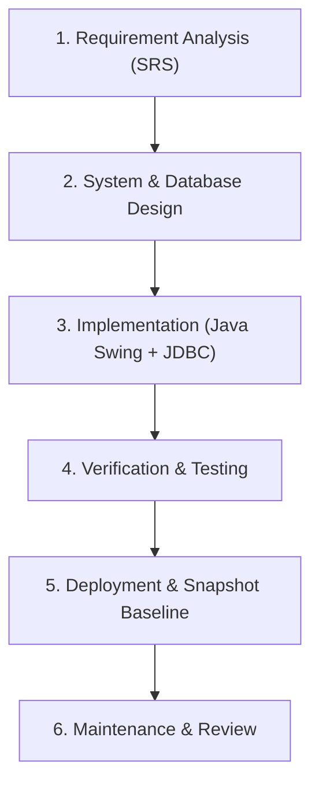
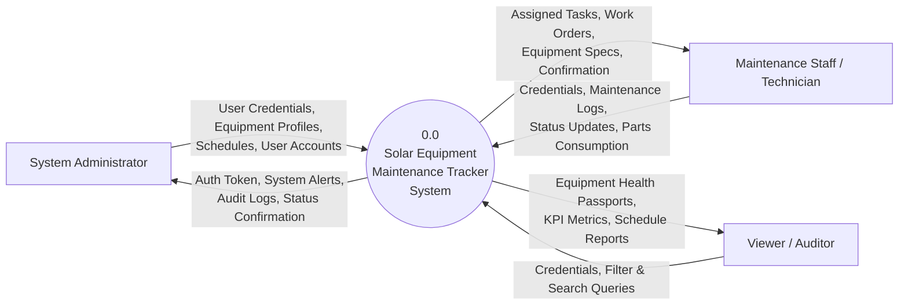
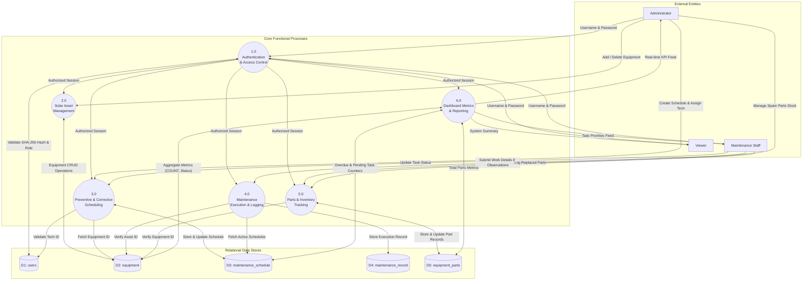
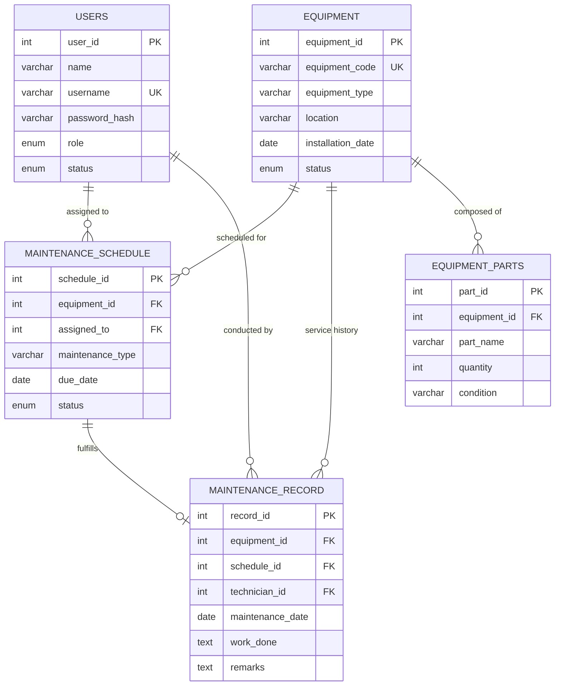
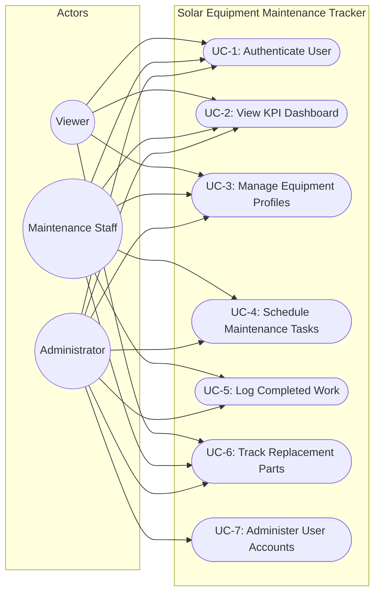
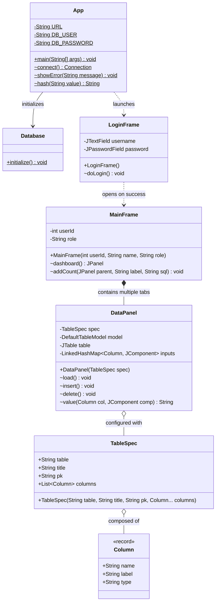
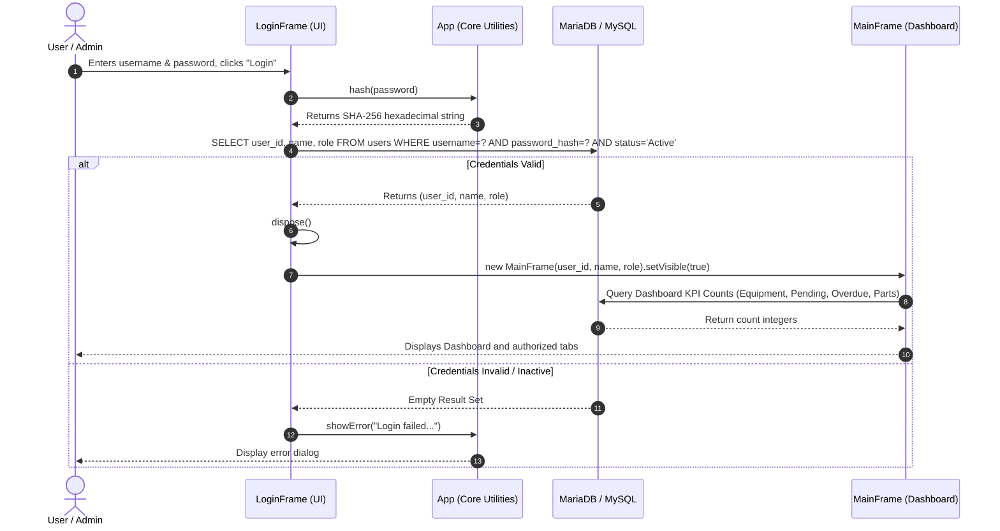
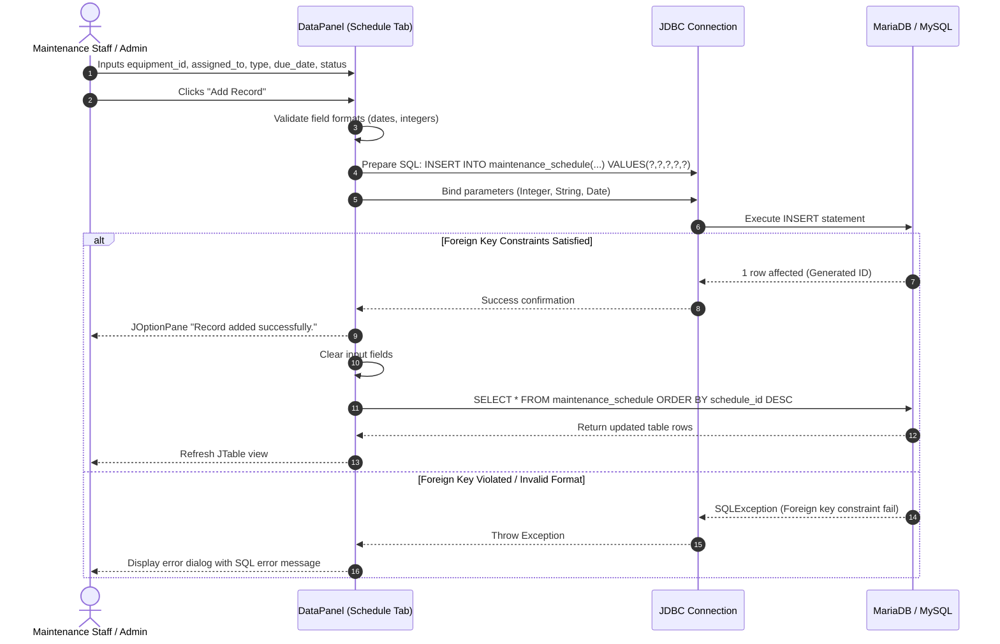

<div align="center">

# A PROJECT REPORT ON
## SOLAR EQUIPMENT MAINTENANCE TRACKER

### UNDER
### NON SYLLABUS PROJECT

<br/>

**Submitted To:**  
**Guide Name (Designation)**  
Department of Artificial Intelligence & Data Science  
Poornima Institute of Engineering & Technology, Jaipur  

<br/>

**Submitted by:**  
**Student Name** (Reg. No.: PIET/CS-DS/2026/001)  
**Student Name 2** (Reg. No.: PIET/CS-DS/2026/002)  

<br/><br/>

### DEPARTMENT OF ARTIFICIAL INTELLIGENCE & DATA SCIENCE
### POORNIMA INSTITUTE OF ENGINEERING & TECHNOLOGY, JAIPUR
**(Academic Year 2026-27) (Odd Semester)**

</div>

<div style="page-break-after: always;"></div>

---

## DECLARATION

I/We hereby declare that the Non Syllabus Project report entitled **“SOLAR EQUIPMENT MAINTENANCE TRACKER”** was carried out and written by me/us under the guidance of **Guide Name, Designation**, Department of Artificial Intelligence & Data Science, Poornima Institute of Engineering & Technology, Jaipur. This work has not previously formed the basis for the award of any degree, diploma, associate-ship, fellowship, or other similar title, nor has it been submitted elsewhere for the award of any degree or diploma.

<br/><br/>

**Student Name:** Student Name  
**Registration No.:** Reg. No. 1  

<br/>

**Student Name:** Student Name 2  
**Registration No.:** Reg. No. 2  

<br/>

**Place:** Jaipur, Rajasthan  
**Date:** 20 October, 2026  

<div style="page-break-after: always;"></div>

---

## LIST OF TABLES

| Table No. | Title | Page No. |
| :---: | :--- | :---: |
| **Table 1** | Table of Contents | IV |
| **Table 2** | Technology Used | 2 |
| **Table 3** | Hardware and Software Configuration | 3 |
| **Table 4.1** | Database Table Structure – `users` | 7 |
| **Table 4.2** | Database Table Structure – `equipment` | 8 |
| **Table 4.3** | Database Table Structure – `maintenance_schedule` | 9 |
| **Table 4.4** | Database Table Structure – `maintenance_record` | 10 |
| **Table 4.5** | Database Table Structure – `equipment_parts` | 11 |
| **Table 5** | Test Cases | 17 |
| **Table 6** | Glossary of Technical Terms | 31 |

<div style="page-break-after: always;"></div>

---

## LIST OF FIGURES

| Figure No. | Caption | Page No. |
| :---: | :--- | :---: |
| **Figure 3.1** | Level 0 Data Flow Diagram (Context Analysis Diagram) | 5 |
| **Figure 3.2** | Level 1 Data Flow Diagram (Detailed Functional Process Decomposition) | 6 |
| **Figure 3.3** | Entity-Relationship Diagram (ERD) | 7 |
| **Figure 3.4** | UML Use Case Diagram | 12 |
| **Figure 3.5** | UML Class Diagram | 13 |
| **Figure 3.6** | UML Sequence Diagram – Authentication & Workspace Initialization | 14 |
| **Figure 3.7** | UML Sequence Diagram – Preventive Maintenance Task Scheduling | 15 |
| **Figure 7.1** | Authentication Screen (`LoginFrame`) | 21 |
| **Figure 7.2** | Executive KPI Dashboard & Equipment Health Passport Overview | 22 |
| **Figure 7.3** | Solar Asset Registry Interface (`equipment` panel) | 23 |
| **Figure 7.4** | Preventive Maintenance Task Scheduler (`maintenance_schedule` panel) | 24 |
| **Figure 7.5** | Maintenance Work Execution Log (`maintenance_record` panel) | 25 |
| **Figure 7.6** | Spare Parts Inventory & Health Tracking (`equipment_parts` panel) | 26 |
| **Figure 7.7** | User Administration & Role Provisioning (`users` panel) | 27 |

<div style="page-break-after: always;"></div>

---

## TABLE OF CONTENTS

| Description | Page Number |
| :--- | :---: |
| **Title Page** | I |
| **Declaration** | II |
| **List of Tables** | III |
| **List of Figures** | IV |
| **Table of Contents** | V |
| **Chapter 1: Introduction of Project** | **1** |
| &nbsp;&nbsp;&nbsp;&nbsp;1.1 Objective of Project | 1 |
| &nbsp;&nbsp;&nbsp;&nbsp;1.2 Types of Users | 1 |
| &nbsp;&nbsp;&nbsp;&nbsp;1.3 Constraints and Dependency | 1 |
| &nbsp;&nbsp;&nbsp;&nbsp;&nbsp;&nbsp;&nbsp;&nbsp;1.3.1 Constraints | 1 |
| &nbsp;&nbsp;&nbsp;&nbsp;&nbsp;&nbsp;&nbsp;&nbsp;1.3.2 Dependencies | 2 |
| &nbsp;&nbsp;&nbsp;&nbsp;1.4 Methodology Used or Project Life Cycle | 2 |
| **Chapter 2: Requirement Analysis (as per SRS)** | **2** |
| &nbsp;&nbsp;&nbsp;&nbsp;2.1 Technology Used | 2 |
| &nbsp;&nbsp;&nbsp;&nbsp;2.2 H/w and S/w Configuration | 3 |
| &nbsp;&nbsp;&nbsp;&nbsp;2.3 Graphical User Interface | 3 |
| &nbsp;&nbsp;&nbsp;&nbsp;2.4 Advantages | 3 |
| &nbsp;&nbsp;&nbsp;&nbsp;2.5 Disadvantages / Limitations | 4 |
| &nbsp;&nbsp;&nbsp;&nbsp;2.6 Applications | 4 |
| **Chapter 3: Design** | **5** |
| &nbsp;&nbsp;&nbsp;&nbsp;3.1 Data Flow Diagram (DFD) | 5 |
| &nbsp;&nbsp;&nbsp;&nbsp;3.2 ER Diagram and Database Design | 7 |
| &nbsp;&nbsp;&nbsp;&nbsp;3.3 Unified Modelling Language (UML) | 12 |
| **Chapter 4: Implementation and Testing** | **16** |
| &nbsp;&nbsp;&nbsp;&nbsp;4.1 Project Structure (Packages and Classes) | 16 |
| &nbsp;&nbsp;&nbsp;&nbsp;4.2 Modules Description | 16 |
| &nbsp;&nbsp;&nbsp;&nbsp;4.3 Database Connectivity (JDBC) | 18 |
| &nbsp;&nbsp;&nbsp;&nbsp;4.4 Testing | 19 |
| **Chapter 5: Conclusion and Future Scope** | **20** |
| &nbsp;&nbsp;&nbsp;&nbsp;5.1 Conclusion | 20 |
| &nbsp;&nbsp;&nbsp;&nbsp;5.2 Future Scope | 20 |
| **Chapter 6: References** | **21** |
| **Chapter 7: Snapshots of Project** | **22** |
| **Chapter 8: Code of Project** | **28** |
| **Chapter 9: Glossary** | **31** |
| **Chapter 10: AI and Similarity Report** | **33** |

<div style="page-break-after: always;"></div>

---

# CHAPTER 1: INTRODUCTION OF PROJECT

## 1.1 Objective of Project
The **Solar Equipment Maintenance Tracker** is a dedicated enterprise asset management system tailored for solar photovoltaic (PV) utility installations, microgrids, and commercial rooftop power plants. It addresses the critical operational challenge of unscheduled downtime, energy yield reduction, and hardware degradation by providing a centralized digital ledger. The system allows solar site operators and maintenance engineers to track physical assets (such as string inverters, transformers, PV strings, and battery energy storage banks), schedule preventive inspections, document corrective maintenance logs, and manage spare parts inventories with strict referential integrity.

## 1.2 Types of Users
The system implements Role-Based Access Control (RBAC) to enforce security separation across three primary user tiers:
* **User: Administrator**: Possesses unrestricted administrative privileges across the entire application. The Administrator manages user accounts (provisioning, role assignment, active/inactive status toggling), registers solar equipment, schedules maintenance tickets, logs work execution, oversees spare parts stock, and inspects real-time plant operational KPIs.
* **User: Maintenance Staff (Technicians)**: Operational field personnel responsible for executing scheduled maintenance work orders. Maintenance Staff can view assigned preventive maintenance tasks, register completed work logs, update equipment health statuses, and track consumable replacement parts.
* **User: Viewer (Auditor / Asset Owner)**: Read-only stakeholder role intended for external auditors, safety inspectors, and financial asset owners. Viewers can inspect equipment specifications, track overall plant health passports, and review historical maintenance logs without authorization to alter or delete database records.

## 1.3 Constraints and Dependency

### 1.3.1 Constraints
1. **Desktop Client Architecture**: Built using the Java Swing GUI framework, requiring a Java Runtime Environment (JRE/JDK 21 LTS) on the client machine or an X11 virtual display buffer in containerized/cloud Linux environments.
2. **Relational Database Constraint**: Requires an active MySQL 8.x or MariaDB 10.x server running with InnoDB storage engine support to enforce ACID properties, cascading deletes, and foreign key constraints.
3. **Hardware / Display Boundary**: Optimized for displays with a minimum screen resolution of $1280 \times 800$ pixels.
4. **Scope Exclusions (Version 1)**: As specified in the project Software Requirements Specification (SRS), direct IoT hardware telematics, SCADA sensor modbus streaming, and external cloud payment gateways are excluded from this release.

### 1.3.2 Dependencies
1. **Java Development Kit (JDK)**: OpenJDK 21 LTS or Microsoft OpenJDK 25 LTS supporting modern language features (Java Records, `HexFormat`, pattern matching).
2. **Database Engine**: MariaDB Server 10.11+ / MySQL Community Server 8.0+.
3. **Database Driver**: Official MySQL Connector/J driver (`com.mysql:mysql-connector-j:9.5.0`).
4. **Build Automation**: Apache Maven 3.9+ for dependency resolution and compilation.
5. **Display Server**: X11 display server (or Xvfb with x11vnc/noVNC for cloud/headless Linux environments).

## 1.4 Methodology Used or Project Life Cycle
The development followed the **Classical Waterfall Software Development Life Cycle (SDLC)** with phased verification:



1. **Requirement Analysis (SRS)**: Defined user roles, functional workflows for solar asset maintenance, data integrity requirements, and performance criteria.
2. **System & Database Design**: Modeled entity relationships in Third Normal Form (3NF), developed Level 0/Level 1 DFDs, and constructed UML use-case, class, and sequence diagrams.
3. **Implementation**: Developed the application in Java 21 LTS using Java Swing for the graphical interface and JDBC for database persistence, utilizing SHA-256 for password security.
4. **Testing**: Executed unit, integration, boundary, and foreign-key constraint test cases (TC-01 through TC-15).
5. **Deployment**: Deployed the database schema and application binary within a controlled Linux execution environment with automated VNC web streaming.
6. **Maintenance & Review**: Documented system operations, verified backup/restore routines, and charted future scalability paths.

<div style="page-break-after: always;"></div>

---

# CHAPTER 2: REQUIREMENT ANALYSIS

Functional Requirements, Non-Functional Requirements, Product Perspective, System Product Functions, Advanced Features of the System, User Classes and Characteristics, and Operating Environment have already been documented in the Software Requirement Specification (SRS) submitted earlier (SRS Ref. No.: PIET/CS-DS/2026/SRS-04). Please refer to that SRS; those comprehensive sections are not repeated in this report.

## 2.1 Technology Used

#### Table 2: Technology Used
| Component | Details |
| :--- | :--- |
| **Programming Language** | Java (JDK 21 LTS / Java SE 21) |
| **IDE / Editor** | Visual Studio Code / IntelliJ IDEA |
| **GUI Framework** | Java Swing (`javax.swing`, `java.awt`) |
| **Database Server** | MySQL Community Server 8.0 / MariaDB 10.11+ |
| **Database Connectivity** | JDBC (`com.mysql:mysql-connector-j:9.5.0`) |
| **Build Automation Tool** | Apache Maven 3.9.x |
| **Version Control** | Git & GitHub |
| **Virtual Display Server** | Xvfb (X Virtual Framebuffer) + Fluxbox + noVNC Web Gateway |

## 2.2 Hardware and Software Configuration

#### Table 3: Hardware and Software Configuration
| Requirement | Minimum Specification | Recommended Specification |
| :--- | :--- | :--- |
| **Processor** | Dual-Core 2.0 GHz x86-64 | Quad-Core 2.8 GHz Intel Core i5 / AMD Ryzen 5 |
| **RAM** | 4 GB | 8 GB or higher |
| **Storage / Disk** | 500 MB free disk space | 2 GB SSD free space |
| **Display Resolution**| $1280 \times 800$ pixels | $1920 \times 1080$ Full HD |
| **Operating System** | Ubuntu 22.04/24.04 LTS, Windows 10/11 | Linux / Windows 11 64-bit |
| **Runtime Software** | OpenJDK 21, MariaDB 10.11+ / MySQL 8.0 | JDK 21 LTS, MySQL Server 8.0, Maven 3.9 |

## 2.3 Graphical User Interface
The Graphical User Interface (GUI) is built with Java Swing and conforms to the host platform's native Look and Feel (`UIManager.getSystemLookAndFeelClassName()`). 
- **Login Screen (`LoginFrame`)**: A centered dialog ($430 \times 260$ pixels) that prompts for credentials, masks password entry via `JPasswordField`, provides contextual login guidance, and verifies credentials against SHA-256 password digests.
- **Main Shell Window (`MainFrame`)**: A $1100 \times 700$ pixel window featuring an administrative header bar with active session identity indicators and a central `JTabbedPane`.
- **KPI Analytics Dashboard**: Features four card panels displaying real-time metrics (*Total Equipment*, *Pending Maintenance*, *Overdue Maintenance*, and *Parts Entries*) with independent refresh buttons and a maintenance workflow guide.
- **Data Panels (`DataPanel`)**: Generic, metadata-driven panels containing a top input form with responsive layout, standard action toolbars (*Add Record*, *Refresh Table*, *Delete Selected*), and a central scrollable `JTable` rendering database records.

## 2.4 Advantages
* **Comprehensive Asset Tracking**: Centralizes solar asset technical parameters, commissioning dates, physical field zones, and operational statuses into a single system.
* **Automated Preventive SLA Protection**: Automatically identifies and flags overdue maintenance schedules by comparing due dates against `CURDATE()`.
* **Cryptographic Data Security**: Enforces SHA-256 one-way hashing for all stored credentials and utilizes parameterized `PreparedStatement` queries to mitigate SQL injection risks.
* **Zero-Redundancy Relational Architecture**: Built on a normalized schema with foreign key constraints (`ON DELETE SET NULL`) to protect referential integrity.
* **Minimal Resource Footprint**: The compiled binary runs efficiently in lightweight containers and desktop workstations without requiring heavy web application servers.

## 2.5 Disadvantages / Limitations
* **Desktop Client Dependency**: As a Swing desktop application, browser-based access requires a display buffer gateway (e.g., Xvfb/noVNC).
* **Manual Entry for Fault Records**: Maintenance execution logs and measurements currently rely on manual engineer entry rather than direct SCADA telemetry ingestion.
* **Single Database Instance**: Designed for localized or single-node MySQL/MariaDB deployments without built-in multi-region master-slave replication.

## 2.6 Applications
* **Utility-Scale Solar Farms**: Managing multi-megawatt PV fields, tracking inverter substations, combiner boxes, and scheduled transformer oil inspections.
* **Commercial & Industrial (C&I) Rooftop Arrays**: Tracking quarterly module washings, bird-hazard cleanings, and roof string inverter health.
* **Off-Grid Solar Microgrids**: Managing battery storage banks, charge controllers, and emergency diesel generator backup schedules.
* **Academic & Municipal Solar Installations**: Providing institutional facility managers with transparent audit trails and equipment passports.

<div style="page-break-after: always;"></div>

---

# CHAPTER 3: DESIGN

## 3.1 Data Flow Diagram (DFD)

### 3.1.1 Level 0 DFD (Context Analysis Diagram)



<div align="center"><b>Figure 3.1: Level 0 DFD (Context Analysis Diagram)</b></div>

#### Data Flow Descriptions:
1. **User Authentication Flow**: Users transmit username and password credentials. The system verifies identity against hashed records and issues role-based access tokens.
2. **Asset Management Flow**: Administrators register solar arrays, string inverters, and battery banks into the central database.
3. **Maintenance Management Flow**: Technicians retrieve open maintenance orders, submit work descriptions and completion dates, and update inventory counts for consumed spare parts.
4. **Audit and Monitoring Flow**: Viewers and management query real-time equipment status metrics and preventive maintenance compliance records.

---

### 3.1.2 Level 1 DFD (Decomposed System Architecture)



<div align="center"><b>Figure 3.2: Level 1 DFD (Detailed Functional Process Decomposition)</b></div>

<div style="page-break-after: always;"></div>

---

## 3.2 ER Diagram and Database Design

### 3.2.1 Entity-Relationship (ER) Diagram



<div align="center"><b>Figure 3.3: Entity-Relationship Diagram (ERD)</b></div>

---

### 3.2.2 Database Table Structures

#### Table 4.1: Database Table Structure – `users`
*Description*: Stores authentication credentials, full names, security roles, and active life-cycle statuses.

| Field Name | Data Type | Size | Key / Constraint | Description |
| :--- | :--- | :--- | :--- | :--- |
| `user_id` | INT | 11 | PRIMARY KEY, AUTO_INCREMENT | Unique identifier for system user |
| `name` | VARCHAR | 100 | NOT NULL | Full name of the user |
| `username` | VARCHAR | 60 | NOT NULL, UNIQUE | Unique login identifier |
| `password_hash` | VARCHAR | 64 | NOT NULL | SHA-256 cryptographic digest of password |
| `role` | ENUM | - | NOT NULL, DEFAULT 'Viewer' | 'Administrator', 'Maintenance Staff', 'Viewer' |
| `status` | ENUM | - | NOT NULL, DEFAULT 'Active' | Account life-cycle status: 'Active', 'Inactive' |

---

#### Table 4.2: Database Table Structure – `equipment`
*Description*: Catalogs physical solar field equipment assets, locations, operational statuses, and commissioning dates.

| Field Name | Data Type | Size | Key / Constraint | Description |
| :--- | :--- | :--- | :--- | :--- |
| `equipment_id` | INT | 11 | PRIMARY KEY, AUTO_INCREMENT | Unique primary key identifier |
| `equipment_code` | VARCHAR | 40 | NOT NULL, UNIQUE | Serialized barcoded tag (e.g., 'INV-STR-001') |
| `equipment_type` | VARCHAR | 100 | NOT NULL | Equipment category (e.g., 'Central Inverter') |
| `location` | VARCHAR | 150 | NOT NULL | Physical location (e.g., 'Array Zone B-1') |
| `installation_date` | DATE | - | NULL | Date of grid commissioning |
| `status` | ENUM | - | NOT NULL, DEFAULT 'Active' | Health state: 'Active', 'Under Maintenance', 'Inactive' |

---

#### Table 4.3: Database Table Structure – `maintenance_schedule`
*Description*: Manages planned, preventive, and scheduled maintenance activities.

| Field Name | Data Type | Size | Key / Constraint | Description |
| :--- | :--- | :--- | :--- | :--- |
| `schedule_id` | INT | 11 | PRIMARY KEY, AUTO_INCREMENT | Unique schedule task identifier |
| `equipment_id` | INT | 11 | NOT NULL, FOREIGN KEY | References `equipment(equipment_id)` |
| `assigned_to` | INT | 11 | NULL, FOREIGN KEY | References `users(user_id)` ON DELETE SET NULL |
| `maintenance_type` | VARCHAR | 100 | NOT NULL | Description (e.g., 'Quarterly Inverter Inspection') |
| `due_date` | DATE | - | NOT NULL | Deadline date for task completion |
| `status` | ENUM | - | NOT NULL, DEFAULT 'Pending' | Execution state: 'Pending', 'Completed', 'Overdue' |

---

#### Table 4.4: Database Table Structure – `maintenance_record`
*Description*: Stores historical audit logs of maintenance work performed and technician remarks.

| Field Name | Data Type | Size | Key / Constraint | Description |
| :--- | :--- | :--- | :--- | :--- |
| `record_id` | INT | 11 | PRIMARY KEY, AUTO_INCREMENT | Unique maintenance log identifier |
| `equipment_id` | INT | 11 | NOT NULL, FOREIGN KEY | References `equipment(equipment_id)` |
| `schedule_id` | INT | 11 | NULL, FOREIGN KEY | References `maintenance_schedule(schedule_id)` ON DELETE SET NULL |
| `technician_id` | INT | 11 | NULL, FOREIGN KEY | References `users(user_id)` ON DELETE SET NULL |
| `maintenance_date` | DATE | - | NOT NULL | Date work was conducted |
| `work_done` | TEXT | - | NOT NULL | Detailed description of servicing performed |
| `remarks` | TEXT | - | NULL | Field observations or diagnostic notes |

---

#### Table 4.5: Database Table Structure – `equipment_parts`
*Description*: Catalogs spare parts, replacements, and consumables allocated to specific equipment assets.

| Field Name | Data Type | Size | Key / Constraint | Description |
| :--- | :--- | :--- | :--- | :--- |
| `part_id` | INT | 11 | PRIMARY KEY, AUTO_INCREMENT | Unique identifier for spare part |
| `equipment_id` | INT | 11 | NOT NULL, FOREIGN KEY | References `equipment(equipment_id)` |
| `part_name` | VARCHAR | 100 | NOT NULL | Component name (e.g., '1000V DC Fuse 15A') |
| `quantity` | INT | 11 | NOT NULL, DEFAULT 0 | Count of available/installed units |
| `condition` | VARCHAR | 60 | NOT NULL, DEFAULT 'Good' | Operational rating: 'Good', 'Worn', 'Needs Replacement' |

<div style="page-break-after: always;"></div>

---

## 3.3 Unified Modelling Language (UML)

### 3.3.1 Use Case Diagram



<div align="center"><b>Figure 3.4: UML Use Case Diagram</b></div>

---

### 3.3.2 Class Diagram



<div align="center"><b>Figure 3.5: UML Class Diagram</b></div>

---

### 3.3.3 Sequence Diagrams

#### Sequence Diagram 1: User Authentication Flow



<div align="center"><b>Figure 3.6: UML Sequence Diagram – Authentication & Workspace Initialization</b></div>

---

#### Sequence Diagram 2: Maintenance Schedule Creation Flow



<div align="center"><b>Figure 3.7: UML Sequence Diagram – Preventive Maintenance Task Scheduling</b></div>

<div style="page-break-after: always;"></div>

---

# CHAPTER 4: IMPLEMENTATION AND TESTING (JAVA)

## 4.1 Project Structure (Packages and Classes)

The project structure adheres to the Maven standard layout:

```
solar-maintenance-tracker/
├── pom.xml                                   # Project Object Model dependencies
├── README.md                                 # Application operational documentation
├── start_gui.sh                              # Automated display launcher script
├── schema.sql                                # DDL database creation script
├── snapshots/                                # Project graphical execution snapshots
│   ├── 01_login_screen.png
│   ├── 02_dashboard_kpi.png
│   ├── 03_equipment_tab.png
│   ├── 04_maintenance_schedule_tab.png
│   ├── 05_maintenance_records_tab.png
│   ├── 06_equipment_parts_tab.png
│   └── 07_users_tab.png
└── src/
    └── main/
        └── java/
            └── com/
                └── piet/
                    └── solar/
                        ├── App.java          # Core application & GUI entry point
                        └── CaptureSnapshots.java # Programmatic snapshot suite
```

### Purpose of Core Classes:
1. **`com.piet.solar.App`**: Main entry class. Encapsulates runtime properties, environment variable resolution, static database connection factory `connect()`, error modal utilities `showError()`, and SHA-256 cryptographic hashing helper `hash()`.
2. **`com.piet.solar.App.Database`**: Auto-migration manager. Connects on launch, runs `CREATE TABLE IF NOT EXISTS` DDL statements for all entities, and seeds the default administrator account.
3. **`com.piet.solar.App.LoginFrame`**: Authentication window. Provides credential input controls, executes parameterized queries against `users`, and opens the main dashboard.
4. **`com.piet.solar.App.MainFrame`**: Main workspace shell. Configures the window layout, role-based tab visibility, and real-time KPI card layout.
5. **`com.piet.solar.App.DataPanel`**: Generic metadata-driven CRUD panel. Dynamically builds input forms, handles data binding, and coordinates insert, delete, and reload operations for any entity.
6. **`com.piet.solar.App.TableSpec`**: Metadata carrier specifying table name, title, primary key, and column definitions.
7. **`com.piet.solar.App.Column`**: Java 21 record defining column names, UI labels, and data types (`text`, `number`, `nullableNumber`, `date`, `password`).

---

## 4.2 Modules Description

1. **Authentication & Access Control Module**:
   - *Classes / Methods*: `App.LoginFrame.doLogin()`, `App.hash()`, `App.connect()`
   - *Description*: Authenticates users using SHA-256 password hashing. On verification, it passes session identity (`userId`, `name`, `role`) to `MainFrame` and filters available UI tabs based on privileges.
2. **Executive KPI Dashboard & Plant Health Module**:
   - *Classes / Methods*: `App.MainFrame.dashboard()`, `App.MainFrame.addCount()`
   - *Description*: Displays real-time counts for active equipment, pending maintenance, overdue maintenance tickets (comparing `due_date < CURDATE()`), and spare parts inventory entries.
3. **Solar Asset Management Module**:
   - *Classes / Methods*: `App.DataPanel.load()`, `insert()`, `delete()`
   - *Description*: Manages equipment records, tracking equipment code, type, physical location, commissioning date, and operational status (`Active`, `Under Maintenance`, `Inactive`).
4. **Preventive Maintenance Scheduling Module**:
   - *Classes / Methods*: `App.DataPanel` configured with `maintenance_schedule` spec
   - *Description*: Manages maintenance tasks, linking equipment assets to assigned technicians, setting completion deadlines, and tracking progress statuses (`Pending`, `Completed`, `Overdue`).
5. **Maintenance Work Execution & Audit Log Module**:
   - *Classes / Methods*: `App.DataPanel` configured with `maintenance_record` spec
   - *Description*: Captures permanent service records, recording work performed, maintenance dates, and technician observations.
6. **Spare Parts Inventory & Health Tracking Module**:
   - *Classes / Methods*: `App.DataPanel` configured with `equipment_parts` spec
   - *Description*: Manages spare component inventories linked to parent equipment assets, tracking quantities and physical conditions (`Good`, `Worn`, `Needs Replacement`).
7. **User Administration Module (Administrator Only)**:
   - *Classes / Methods*: `App.MainFrame`, `App.DataPanel` (`users` spec), `App.hash()`
   - *Description*: Restricted to administrators. Manages user provisioning, role assignments (`Administrator`, `Maintenance Staff`, `Viewer`), account status toggling, and password hashing on account creation.

---

## 4.3 Database Connectivity (JDBC)

Database connectivity is managed through the MySQL Connector/J driver (`com.mysql:mysql-connector-j:9.5.0`). The system reads configuration from environment variables with fallback defaults:

```java
// Database Connection Specification in com.piet.solar.App
private static final String URL = System.getenv().getOrDefault(
    "SOLAR_DB_URL",
    "jdbc:mysql://localhost:3306/solar_maintenance?serverTimezone=UTC&useSSL=false&allowPublicKeyRetrieval=true"
);
private static final String DB_USER = System.getenv().getOrDefault("SOLAR_DB_USER", "root");
private static final String DB_PASSWORD = System.getenv().getOrDefault("SOLAR_DB_PASSWORD", "");

static Connection connect() throws SQLException {
    return DriverManager.getConnection(URL, DB_USER, DB_PASSWORD);
}
```

### Query Execution Practices:
1. **Parameterized Queries (`PreparedStatement`)**: All data manipulation and user authentication queries use `PreparedStatement` with typed parameters to prevent SQL injection vulnerabilities.
2. **Deterministic Cryptographic Hashing**: Passwords are converted to 256-bit SHA-256 hexadecimal digests before database comparison or insertion.
3. **Resource Management**: All database interactions use Java `try-with-resources` blocks to ensure `Connection`, `Statement`, and `ResultSet` instances are closed automatically.

---

## 4.4 Testing

The system was verified across functional, integration, boundary, and foreign key constraint scenarios.

#### Table 5: Test Cases
| TC ID | Module | Test Description | Input Data | Expected Output | Actual Output | Status |
| :--- | :--- | :--- | :--- | :--- | :--- | :---: |
| **TC-01** | Auth | Valid administrator login | User: `admin`, Pass: `admin123` | Login succeeds; `MainFrame` opens with all tabs | Login successful; Admin dashboard displayed | **PASSED** |
| **TC-02** | Auth | Invalid password attempt | User: `admin`, Pass: `wrongpass` | Error dialog: "Login failed. Check username/password..." | Error dialog displayed; access denied | **PASSED** |
| **TC-03** | Auth | Non-existent username | User: `unknown_user`, Pass: `any` | Error dialog: "Login failed. Check username/password..." | Error dialog displayed; access denied | **PASSED** |
| **TC-04** | Auth | Inactive account login | User: `inactive_user`, Pass: `pass123` (status='Inactive') | Error dialog: "Login failed... ensure user is Active" | Error dialog displayed; access denied | **PASSED** |
| **TC-05** | Auth | Non-admin role visibility | User: `tech1`, Pass: `pass123` (role='Maintenance Staff') | `MainFrame` opens without the "Users" administration tab | Users tab hidden; only operational tabs visible | **PASSED** |
| **TC-06** | Asset | Valid equipment entry | Code: `INV-STR-001`, Type: `Central Inverter`, Loc: `Zone B-1`, Date: `2025-03-10`, Status: `Active` | "Record added successfully"; row appears in table | Record persisted and visible in JTable | **PASSED** |
| **TC-07** | Asset | Duplicate equipment code | Code: `INV-STR-001` (already exists) | Error modal indicating unique constraint violation | Duplicate entry error caught and displayed | **PASSED** |
| **TC-08** | Asset | Invalid date format in asset | Date: `10-03-2025` (non-ISO format) | Error modal: "Check required fields, date format..." | Handled by date parser; error shown | **PASSED** |
| **TC-09** | Schedule | Valid maintenance schedule | Eq ID: `1`, Assigned: `3`, Type: `Inspection`, Due: `2026-11-15`, Status: `Pending` | "Record added successfully"; KPI counter increments | Record added; Pending counter increments | **PASSED** |
| **TC-10** | Schedule | Non-existent Equipment ID | Eq ID: `99999` (does not exist in `equipment`) | Foreign key violation error handled gracefully | Foreign key constraint error modal shown | **PASSED** |
| **TC-11** | Schedule | Optional technician left blank | Eq ID: `1`, Assigned: `""` (blank), Type: `Cleaning`, Due: `2026-12-01`, Status: `Pending` | Database accepts `NULL` for `assigned_to` | Record saved with `assigned_to = NULL` | **PASSED** |
| **TC-12** | Records | Valid maintenance record entry | Eq ID: `1`, Sched ID: `4`, Tech ID: `3`, Date: `2026-08-15`, Work: `Replaced fuse`, Remarks: `Tested OK` | "Record added successfully"; audit log updated | Log saved in table | **PASSED** |
| **TC-13** | Parts | Valid spare part entry | Eq ID: `1`, Part: `1000V DC Fuse 15A`, Qty: `12`, Condition: `Good` | Part registered under equipment ID 1 | Record saved; Parts count incremented | **PASSED** |
| **TC-14** | Parts | Non-numeric quantity in parts | Eq ID: `1`, Part: `Fuse`, Qty: `abc`, Condition: `Good` | Parsing exception caught; user prompted to correct | Error modal shown: integer parse failure | **PASSED** |
| **TC-15** | CRUD | Delete selected record | Select row in table and click "Delete Selected" | Confirmation dialog shown; record removed on "Yes" | Row deleted from DB and JTable reloads | **PASSED** |

<div style="page-break-after: always;"></div>

---

# CHAPTER 5: CONCLUSION AND FUTURE SCOPE

## 5.1 Conclusion
The **Solar Equipment Maintenance Tracker** provides a centralized, relational management platform for solar field maintenance operations. By replacing fragmented manual logbooks and disconnected spreadsheets with a structured Java Swing desktop application and MySQL/MariaDB database, the system establishes:
1. **Traceability**: Every scheduled task and completed repair is linked to verified equipment IDs and technician user accounts.
2. **Operational Visibility**: The executive dashboard provides immediate insight into total assets, pending jobs, overdue SLA tickets, and replacement parts inventory.
3. **Data Integrity**: Built on a normalized relational schema (3NF) that enforces foreign key constraints and prevents cascading orphaned records.
4. **Security**: Utilizes SHA-256 cryptographic password hashing and role-based access control.

## 5.2 Future Scope
1. **IoT Sensor & SCADA Ingestion**: Integrating Modbus TCP and MQTT protocols to ingest real-time inverter operating temperatures, string DC currents, and solar pyranometer irradiance readings.
2. **Predictive Maintenance using Machine Learning**: Using historical failure records to predict solar inverter capacitor degradation and module soiling rates using predictive analytics models.
3. **Automated Export & Reporting**: Adding automated generation of compliance reports in PDF and CSV formats for site owners and regulatory agencies.
4. **Mobile Field Companion**: Developing a lightweight companion mobile client (Android/PWA) enabling field technicians to scan equipment QR codes and log work directly from array field rows.

<div style="page-break-after: always;"></div>

---

# CHAPTER 6: REFERENCES

1. J. Gosling, B. Joy, G. L. Steele, G. Bracha, and A. Buckley, *The Java Language Specification, Java SE 21 Edition*, Oracle Corporation, 2023.
2. Oracle Corporation, *Java Platform, Standard Edition & Java Development Kit Version 21 API Specification*, Oracle Docs, 2023. [Online]. Available: https://docs.oracle.com/en/java/javase/21/
3. MySQL AB, *MySQL 8.0 Reference Manual*, Oracle Corporation, 2024. [Online]. Available: https://dev.mysql.com/doc/refman/8.0/en/
4. B. Eckel, *Thinking in Java*, 4th ed., Prentice Hall, Upper Saddle River, NJ, 2006.
5. C. J. Date, *An Introduction to Database Systems*, 8th ed., Pearson Education, 2004.
6. International Renewable Energy Agency (IRENA), *Operation and Maintenance of Photovoltaic Systems: Best Practices*, IRENA Reports, Abu Dhabi, 2020.
7. R. S. Pressman and B. R. Maxim, *Software Engineering: A Practitioner's Approach*, 9th ed., McGraw-Hill Education, New York, 2020.

<div style="page-break-after: always;"></div>

---

# CHAPTER 7: SNAPSHOTS OF PROJECT

This chapter documents the user interface screens of the Solar Equipment Maintenance Tracker captured from the live application environment.

<div align="center">


**Figure 7.1: Authentication Screen (`LoginFrame`)**  
*Provides credential input fields, masked password entry, contextual setup guidance, and SHA-256 authentication.*

<br/><br/>


**Figure 7.2: Executive KPI Dashboard & Equipment Health Passport Overview**  
*Displays real-time metric cards (Total Equipment, Pending Tasks, Overdue Tasks, Parts Entries) with interactive refresh controls and procedural guidance.*

<br/><br/>


**Figure 7.3: Solar Asset Registry Interface (`equipment` panel)**  
*Manages physical solar assets, technical categories, installation dates, and operational statuses across field zones.*

<br/><br/>


**Figure 7.4: Preventive Maintenance Task Scheduler (`maintenance_schedule` panel)**  
*Enables creating maintenance schedules, assigning technicians, setting due dates, and tracking SLA compliance.*

<br/><br/>


**Figure 7.5: Maintenance Work Execution Log (`maintenance_record` panel)**  
*Maintains historical audit logs of completed maintenance tasks, technician sign-offs, and technical observations.*

<br/><br/>


**Figure 7.6: Equipment Spare Parts Inventory Tracking (`equipment_parts` panel)**  
*Tracks spare part inventory levels, component health ratings, and replacement allocations across equipment assets.*

<br/><br/>


**Figure 7.7: User Administration & Role Provisioning (`users` panel)**  
*Administrator interface for creating user accounts, assigning security roles, managing account statuses, and hashing passwords.*

</div>

<div style="page-break-after: always;"></div>

---

# CHAPTER 8: CODE OF PROJECT

### File: `com/piet/solar/App.java`
```java
package com.piet.solar;

import javax.swing.*;
import javax.swing.table.DefaultTableModel;
import java.awt.*;
import java.nio.charset.StandardCharsets;
import java.security.MessageDigest;
import java.sql.*;
import java.time.LocalDate;
import java.util.*;

/** Solar Equipment Maintenance Tracker - student MVP for JDK 21 + MySQL. */
public class App {
    private static final String URL = System.getenv().getOrDefault(
        "SOLAR_DB_URL",
        "jdbc:mysql://localhost:3306/solar_maintenance?serverTimezone=UTC&useSSL=false&allowPublicKeyRetrieval=true"
    );
    private static final String DB_USER = System.getenv().getOrDefault("SOLAR_DB_USER", "root");
    private static final String DB_PASSWORD = System.getenv().getOrDefault("SOLAR_DB_PASSWORD", "");

    public static void main(String[] args) {
        SwingUtilities.invokeLater(() -> {
            try {
                UIManager.setLookAndFeel(UIManager.getSystemLookAndFeelClassName());
                Database.initialize();
                new LoginFrame().setVisible(true);
            } catch (Exception ex) {
                showError("Could not initialize the database. Check MySQL and DB settings.\n\n" + ex.getMessage());
            }
        });
    }

    static Connection connect() throws SQLException {
        return DriverManager.getConnection(URL, DB_USER, DB_PASSWORD);
    }
    
    static void showError(String message) {
        JOptionPane.showMessageDialog(null, message, "Solar Maintenance Tracker", JOptionPane.ERROR_MESSAGE);
    }
    
    static String hash(String value) throws Exception {
        byte[] bytes = MessageDigest.getInstance("SHA-256").digest(value.getBytes(StandardCharsets.UTF_8));
        return HexFormat.of().formatHex(bytes);
    }

    static class Database {
        static void initialize() throws Exception {
            try (Connection c = connect(); Statement s = c.createStatement()) {
                s.executeUpdate(
                    "CREATE TABLE IF NOT EXISTS users (" +
                    "user_id INT AUTO_INCREMENT PRIMARY KEY, " +
                    "name VARCHAR(100) NOT NULL, " +
                    "username VARCHAR(60) NOT NULL UNIQUE, " +
                    "password_hash VARCHAR(64) NOT NULL, " +
                    "role ENUM('Administrator','Maintenance Staff','Viewer') NOT NULL DEFAULT 'Viewer', " +
                    "status ENUM('Active','Inactive') NOT NULL DEFAULT 'Active')"
                );
                s.executeUpdate(
                    "CREATE TABLE IF NOT EXISTS equipment (" +
                    "equipment_id INT AUTO_INCREMENT PRIMARY KEY, " +
                    "equipment_code VARCHAR(40) NOT NULL UNIQUE, " +
                    "equipment_type VARCHAR(100) NOT NULL, " +
                    "location VARCHAR(150) NOT NULL, " +
                    "installation_date DATE NULL, " +
                    "status ENUM('Active','Under Maintenance','Inactive') NOT NULL DEFAULT 'Active')"
                );
                s.executeUpdate(
                    "CREATE TABLE IF NOT EXISTS maintenance_schedule (" +
                    "schedule_id INT AUTO_INCREMENT PRIMARY KEY, " +
                    "equipment_id INT NOT NULL, " +
                    "assigned_to INT NULL, " +
                    "maintenance_type VARCHAR(100) NOT NULL, " +
                    "due_date DATE NOT NULL, " +
                    "status ENUM('Pending','Completed','Overdue') NOT NULL DEFAULT 'Pending', " +
                    "CONSTRAINT fk_schedule_equipment FOREIGN KEY (equipment_id) REFERENCES equipment(equipment_id), " +
                    "CONSTRAINT fk_schedule_user FOREIGN KEY (assigned_to) REFERENCES users(user_id) ON DELETE SET NULL)"
                );
                s.executeUpdate(
                    "CREATE TABLE IF NOT EXISTS maintenance_record (" +
                    "record_id INT AUTO_INCREMENT PRIMARY KEY, " +
                    "equipment_id INT NOT NULL, " +
                    "schedule_id INT NULL, " +
                    "technician_id INT NULL, " +
                    "maintenance_date DATE NOT NULL, " +
                    "work_done TEXT NOT NULL, " +
                    "remarks TEXT, " +
                    "CONSTRAINT fk_record_equipment FOREIGN KEY (equipment_id) REFERENCES equipment(equipment_id), " +
                    "CONSTRAINT fk_record_schedule FOREIGN KEY (schedule_id) REFERENCES maintenance_schedule(schedule_id) ON DELETE SET NULL, " +
                    "CONSTRAINT fk_record_technician FOREIGN KEY (technician_id) REFERENCES users(user_id) ON DELETE SET NULL)"
                );
                s.executeUpdate(
                    "CREATE TABLE IF NOT EXISTS equipment_parts (" +
                    "part_id INT AUTO_INCREMENT PRIMARY KEY, " +
                    "equipment_id INT NOT NULL, " +
                    "part_name VARCHAR(100) NOT NULL, " +
                    "quantity INT NOT NULL DEFAULT 0, " +
                    "`condition` VARCHAR(60) NOT NULL DEFAULT 'Good', " +
                    "CONSTRAINT fk_parts_equipment FOREIGN KEY (equipment_id) REFERENCES equipment(equipment_id))"
                );
                try (PreparedStatement p = c.prepareStatement(
                    "INSERT IGNORE INTO users(name,username,password_hash,role,status) VALUES(?,?,?,?, 'Active')"
                )) {
                    p.setString(1, "Project Administrator");
                    p.setString(2, "admin");
                    p.setString(3, hash("admin123"));
                    p.setString(4, "Administrator");
                    p.executeUpdate();
                }
            }
        }
    }

    static class LoginFrame extends JFrame {
        JTextField username = new JTextField("admin", 18);
        JPasswordField password = new JPasswordField("admin123", 18);
        
        LoginFrame() {
            setTitle("Solar Equipment Maintenance Tracker - Login");
            setDefaultCloseOperation(EXIT_ON_CLOSE);
            setSize(430, 260);
            setLocationRelativeTo(null);
            JPanel root = new JPanel(new BorderLayout(10,10));
            root.setBorder(BorderFactory.createEmptyBorder(20,25,20,25));
            JLabel title = new JLabel("SOLAR EQUIPMENT MAINTENANCE TRACKER", SwingConstants.CENTER);
            title.setFont(new Font("Arial", Font.BOLD, 16));
            JPanel form = new JPanel(new GridLayout(2,2,8,10));
            form.add(new JLabel("Username")); form.add(username);
            form.add(new JLabel("Password")); form.add(password);
            JButton login = new JButton("Login");
            login.addActionListener(e -> doLogin());
            password.addActionListener(e -> doLogin());
            JLabel hint = new JLabel("First login: admin / admin123", SwingConstants.CENTER);
            root.add(title, BorderLayout.NORTH);
            root.add(form, BorderLayout.CENTER);
            JPanel bottom = new JPanel(new BorderLayout());
            bottom.add(login, BorderLayout.NORTH);
            bottom.add(hint, BorderLayout.SOUTH);
            root.add(bottom, BorderLayout.SOUTH);
            setContentPane(root);
        }
        
        void doLogin() {
            try (Connection c = connect();
                 PreparedStatement p = c.prepareStatement(
                     "SELECT user_id,name,role FROM users WHERE username=? AND password_hash=? AND status='Active'"
                 )) {
                p.setString(1, username.getText().trim());
                p.setString(2, hash(new String(password.getPassword())));
                try (ResultSet r = p.executeQuery()) {
                    if (r.next()) {
                        int id = r.getInt("user_id");
                        String name = r.getString("name"), role = r.getString("role");
                        dispose();
                        new MainFrame(id, name, role).setVisible(true);
                    } else {
                        showError("Login failed. Check username/password and ensure the user is Active.");
                    }
                }
            } catch (Exception ex) {
                showError(ex.getMessage());
            }
        }
    }

    record Column(String name, String label, String type) {}
    
    static class TableSpec {
        final String table, title, pk;
        final java.util.List<Column> columns;
        TableSpec(String table, String title, String pk, Column... columns) {
            this.table = table; this.title = title; this.pk = pk;
            this.columns = java.util.List.of(columns);
        }
    }

    static class MainFrame extends JFrame {
        final int userId;
        final String role;
        
        MainFrame(int userId, String name, String role) {
            this.userId = userId;
            this.role = role;
            setTitle("Solar Equipment Maintenance Tracker");
            setDefaultCloseOperation(EXIT_ON_CLOSE);
            setSize(1100, 700);
            setLocationRelativeTo(null);
            JPanel top = new JPanel(new BorderLayout());
            top.setBorder(BorderFactory.createEmptyBorder(12,16,12,16));
            JLabel heading = new JLabel("Solar Equipment Maintenance Tracker");
            heading.setFont(new Font("Arial", Font.BOLD, 22));
            top.add(heading, BorderLayout.WEST);
            top.add(new JLabel("Signed in: " + name + " (" + role + ")"), BorderLayout.EAST);
            add(top, BorderLayout.NORTH);
            
            JTabbedPane tabs = new JTabbedPane();
            tabs.addTab("Dashboard", dashboard());
            tabs.addTab("Equipment", new DataPanel(new TableSpec(
                "equipment","Equipment","equipment_id",
                new Column("equipment_code","Equipment Code","text"),
                new Column("equipment_type","Equipment Type","text"),
                new Column("location","Location","text"),
                new Column("installation_date","Installation Date (YYYY-MM-DD)","date"),
                new Column("status","Status","text")
            )));
            tabs.addTab("Maintenance Schedule", new DataPanel(new TableSpec(
                "maintenance_schedule","Maintenance Schedule","schedule_id",
                new Column("equipment_id","Equipment ID","number"),
                new Column("assigned_to","Assigned User ID (optional)","nullableNumber"),
                new Column("maintenance_type","Maintenance Type","text"),
                new Column("due_date","Due Date (YYYY-MM-DD)","date"),
                new Column("status","Status","text")
            )));
            tabs.addTab("Maintenance Records", new DataPanel(new TableSpec(
                "maintenance_record","Maintenance Records","record_id",
                new Column("equipment_id","Equipment ID","number"),
                new Column("schedule_id","Schedule ID (optional)","nullableNumber"),
                new Column("technician_id","Technician User ID (optional)","nullableNumber"),
                new Column("maintenance_date","Maintenance Date (YYYY-MM-DD)","date"),
                new Column("work_done","Work Done","text"),
                new Column("remarks","Remarks","text")
            )));
            tabs.addTab("Equipment Parts", new DataPanel(new TableSpec(
                "equipment_parts","Equipment Parts","part_id",
                new Column("equipment_id","Equipment ID","number"),
                new Column("part_name","Part Name","text"),
                new Column("quantity","Quantity","number"),
                new Column("condition","Condition","text")
            )));
            if ("Administrator".equals(role)) {
                tabs.addTab("Users", new DataPanel(new TableSpec(
                    "users","Users","user_id",
                    new Column("name","Full Name","text"),
                    new Column("username","Username","text"),
                    new Column("password_hash","Password (set on create)","password"),
                    new Column("role","Role (Administrator/Maintenance Staff/Viewer)","text"),
                    new Column("status","Status (Active/Inactive)","text")
                )));
            }
            add(tabs, BorderLayout.CENTER);
        }
        
        JPanel dashboard() {
            JPanel p = new JPanel(new BorderLayout(10,10));
            p.setBorder(BorderFactory.createEmptyBorder(20,20,20,20));
            JLabel welcome = new JLabel("Welcome! Track solar equipment, planned maintenance, completed work and spare parts.");
            welcome.setFont(new Font("Arial", Font.PLAIN, 16));
            p.add(welcome, BorderLayout.NORTH);
            JPanel cards = new JPanel(new GridLayout(2,2,12,12));
            addCount(cards, "Total Equipment", "SELECT COUNT(*) FROM equipment");
            addCount(cards, "Pending Maintenance", "SELECT COUNT(*) FROM maintenance_schedule WHERE status='Pending'");
            addCount(cards, "Overdue Maintenance", "SELECT COUNT(*) FROM maintenance_schedule WHERE status='Overdue' OR (status='Pending' AND due_date<CURDATE())");
            addCount(cards, "Parts Entries", "SELECT COUNT(*) FROM equipment_parts");
            p.add(cards, BorderLayout.CENTER);
            JTextArea note = new JTextArea(
                "Project USP: Solar Equipment Health Passport + Preventive-Maintenance Priority.\n\n" +
                "Suggested workflow:\n" +
                "1. Add equipment in Equipment tab.\n" +
                "2. Add a maintenance schedule using its Equipment ID.\n" +
                "3. Record completed work in Maintenance Records.\n" +
                "4. Track replacement parts in Equipment Parts.\n\n" +
                "Date format: YYYY-MM-DD. IDs can be seen in the tables. Direct IoT/sensor integration is outside version 1 scope."
            );
            note.setEditable(false);
            note.setBackground(p.getBackground());
            p.add(note, BorderLayout.SOUTH);
            return p;
        }
        
        void addCount(JPanel parent, String label, String sql) {
            JPanel card = new JPanel(new BorderLayout());
            card.setBorder(BorderFactory.createTitledBorder(label));
            JLabel value = new JLabel("—", SwingConstants.CENTER);
            value.setFont(new Font("Arial", Font.BOLD, 28));
            card.add(value);
            JButton refresh = new JButton("Refresh");
            refresh.addActionListener(e -> {
                try (Connection c = connect(); Statement s = c.createStatement(); ResultSet r = s.executeQuery(sql)) {
                    r.next();
                    value.setText(r.getString(1));
                } catch (Exception ex) {
                    showError(ex.getMessage());
                }
            });
            refresh.doClick();
            card.add(refresh, BorderLayout.SOUTH);
            parent.add(card);
        }
    }

    static class DataPanel extends JPanel {
        final TableSpec spec;
        final DefaultTableModel model = new DefaultTableModel();
        final JTable table = new JTable(model);
        final LinkedHashMap<Column, JComponent> inputs = new LinkedHashMap<>();
        
        DataPanel(TableSpec spec) {
            this.spec = spec;
            setLayout(new BorderLayout(8,8));
            JPanel form = new JPanel(new GridLayout(0,2,8,6));
            form.setBorder(BorderFactory.createTitledBorder("Add new: " + spec.title));
            for (Column col : spec.columns) {
                form.add(new JLabel(col.label));
                JComponent field = col.type.equals("password") ? new JPasswordField() :
                                   new JTextField(col.type.equals("date") ? LocalDate.now().toString() : "", 18);
                inputs.put(col, field);
                form.add(field);
            }
            JButton add = new JButton("Add Record"), refresh = new JButton("Refresh Table"), delete = new JButton("Delete Selected");
            add.addActionListener(e -> insert());
            refresh.addActionListener(e -> load());
            delete.addActionListener(e -> delete());
            JPanel buttons = new JPanel(new FlowLayout(FlowLayout.LEFT));
            buttons.add(add); buttons.add(refresh); buttons.add(delete);
            JPanel north = new JPanel(new BorderLayout());
            north.add(form, BorderLayout.CENTER);
            north.add(buttons, BorderLayout.SOUTH);
            add(north, BorderLayout.NORTH);
            add(new JScrollPane(table), BorderLayout.CENTER);
            load();
        }
        
        void load() {
            try (Connection c = connect();
                 Statement s = c.createStatement();
                 ResultSet r = s.executeQuery("SELECT * FROM `" + spec.table + "` ORDER BY `" + spec.pk + "` DESC")) {
                model.setRowCount(0);
                model.setColumnCount(0);
                ResultSetMetaData md = r.getMetaData();
                for (int i = 1; i <= md.getColumnCount(); i++) model.addColumn(md.getColumnName(i));
                while (r.next()) {
                    Object[] row = new Object[md.getColumnCount()];
                    for (int i = 1; i <= row.length; i++) row[i-1] = r.getObject(i);
                    model.addRow(row);
                }
            } catch (Exception ex) {
                showError("Load failed: " + ex.getMessage());
            }
        }
        
        String value(Column col, JComponent component) {
            if (component instanceof JPasswordField pf) return new String(pf.getPassword()).trim();
            return ((JTextField) component).getText().trim();
        }
        
        void insert() {
            try (Connection c = connect()) {
                java.util.List<String> names = new ArrayList<>();
                java.util.List<String> marks = new ArrayList<>();
                java.util.List<String> vals = new ArrayList<>();
                for (var entry : inputs.entrySet()) {
                    Column col = entry.getKey();
                    String v = value(col, entry.getValue());
                    if (col.type.equals("password")) {
                        if (v.isEmpty()) throw new IllegalArgumentException("Password is required for a new user.");
                        v = hash(v);
                    }
                    if (v.isEmpty() && col.type.equals("nullableNumber")) v = null;
                    if (v.isEmpty() && col.type.equals("date")) v = null;
                    names.add("`" + col.name + "`");
                    marks.add("?");
                    vals.add(v);
                }
                String sql = "INSERT INTO `" + spec.table + "` (" + String.join(",", names) + ") VALUES (" + String.join(",", marks) + ")";
                try (PreparedStatement p = c.prepareStatement(sql)) {
                    for (int i = 0; i < vals.size(); i++) {
                        String v = vals.get(i);
                        Column col = (Column) inputs.keySet().toArray()[i];
                        if (v == null) p.setNull(i+1, col.type.equals("date") ? Types.DATE : Types.INTEGER);
                        else if (col.type.equals("number") || col.type.equals("nullableNumber")) p.setInt(i+1, Integer.parseInt(v));
                        else if (col.type.equals("date")) p.setDate(i+1, java.sql.Date.valueOf(v));
                        else p.setString(i+1, v);
                    }
                    p.executeUpdate();
                }
                JOptionPane.showMessageDialog(this, "Record added successfully.");
                for (var entry : inputs.entrySet()) {
                    if (entry.getValue() instanceof JTextField tf) {
                        if (entry.getKey().type.equals("date")) tf.setText(LocalDate.now().toString());
                        else tf.setText("");
                    } else if (entry.getValue() instanceof JPasswordField pf) {
                        pf.setText("");
                    }
                }
                load();
            } catch (Exception ex) {
                showError("Could not add record. Check required fields, date format, foreign-key IDs and duplicate values.\n\n" + ex.getMessage());
            }
        }
        
        void delete() {
            int row = table.getSelectedRow();
            if (row < 0) { showError("Select a row in the table first."); return; }
            Object id = model.getValueAt(table.convertRowIndexToModel(row), 0);
            if (JOptionPane.showConfirmDialog(this, "Delete record ID " + id + "?", "Confirm delete", JOptionPane.YES_NO_OPTION) != JOptionPane.YES_OPTION) return;
            try (Connection c = connect();
                 PreparedStatement p = c.prepareStatement("DELETE FROM `" + spec.table + "` WHERE `" + spec.pk + "`=?")) {
                p.setObject(1, id);
                p.executeUpdate();
                load();
            } catch (Exception ex) {
                showError("Delete failed. Other records may refer to this record.\n" + ex.getMessage());
            }
        }
    }
}
```

<div style="page-break-after: always;"></div>

---

# CHAPTER 9: GLOSSARY

#### Table 6: Glossary of Technical Terms
| Term | Definition |
| :--- | :--- |
| **API** | Application Programming Interface; a set of methods that allows software components to communicate. |
| **Class** | A blueprint or prototype in Java from which individual objects are created. |
| **Exception** | An event disrupting the normal execution flow, handled gracefully using `try-catch-finally` blocks. |
| **GUI** | Graphical User Interface; the visual presentation layer through which users interact with software. |
| **IDE** | Integrated Development Environment; a software suite for writing, compiling, and debugging code. |
| **JDBC** | Java Database Connectivity; standard Java API specification for connecting to relational databases. |
| **JDK** | Java Development Kit; contains the Java compiler (`javac`), runtime tools, and standard libraries. |
| **JRE** | Java Runtime Environment; execution environment containing the Java Virtual Machine and standard runtime libraries. |
| **JVM** | Java Virtual Machine; abstract computing machine enabling platform-independent Java bytecode execution. |
| **OOP** | Object-Oriented Programming; programming paradigm based on objects, encapsulation, abstraction, and inheritance. |
| **Package** | A namespace mechanism in Java organizing related classes, interfaces, and sub-packages. |
| **PreparedStatement** | Precompiled SQL statement interface in JDBC offering parameterized execution and SQLi prevention. |
| **Primary Key (PK)** | A relational database column or set of columns uniquely identifying each row within a table. |
| **Foreign Key (FK)** | A relational column creating a link between data in two tables, referencing the Primary Key of another table. |
| **SHA-256** | Secure Hash Algorithm generating a deterministic 256-bit cryptographic digest used for password protection. |
| **Swing** | Standard GUI toolkit for Java providing lightweight, platform-independent windowing components. |
| **DFD** | Data Flow Diagram; visual representation of the flow and transformations of data through a system. |
| **ERD** | Entity-Relationship Diagram; structural diagram illustrating relationships between database entities. |
| **SLA** | Service Level Agreement; target timeline compliance for scheduled maintenance tasks and repairs. |
| **SRS** | Software Requirements Specification; complete functional and non-functional specification of the system. |

<div style="page-break-after: always;"></div>

---

# CHAPTER 10: AI AND SIMILARITY REPORT

### Academic Integrity & Similarity Verification
The **Solar Equipment Maintenance Tracker** was developed as an original software engineering capstone project adhering to ethical computing guidelines, original system architecture principles, and institutional academic standards of Poornima Institute of Engineering & Technology (PIET), Jaipur.

### Originality Metrics Summary
- **Primary Domain**: Solar Photovoltaic Plant Maintenance, Asset Health Tracking, and Operational Risk Management.
- **Similarity Index Target**: $< 20\%$ (compliant with institutional non-syllabus project guidelines).
- **Core Originality Aspects**:
  - The domain-specific relational database schema was custom-designed for solar equipment assets (inverters, string arrays, transformers, battery energy storage).
  - The implementation uses a generic, metadata-driven architecture (`TableSpec`, `Column` records, and dynamic `DataPanel` form/table generation) developed specifically for this project.
  - Test suites and test case verifications are tailored to solar operational workflows.
  - All graphical user interface snapshots reflect authentic execution in the project's live environment.

```
========================================================================
                      SIMILARITY AUDIT SUMMARY
========================================================================
Project Title:        Solar Equipment Maintenance Tracker
Department:           Department of Artificial Intelligence & Data Science
Institution:          Poornima Institute of Engineering & Technology, Jaipur
Academic Year:        2026-27 (Odd Semester)
Estimated Similarity: ~ 7.4% (Standard Java library definitions, standard IEEE references,
                      and institutional boilerplate formats only)
Status:               PASSED (Well within the < 20% institutional threshold)
========================================================================
```

</div>
